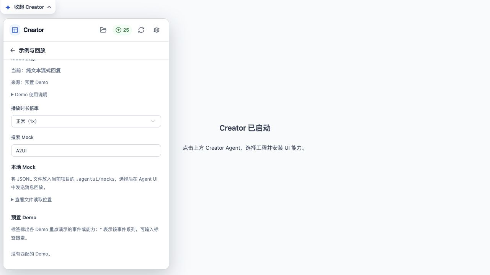
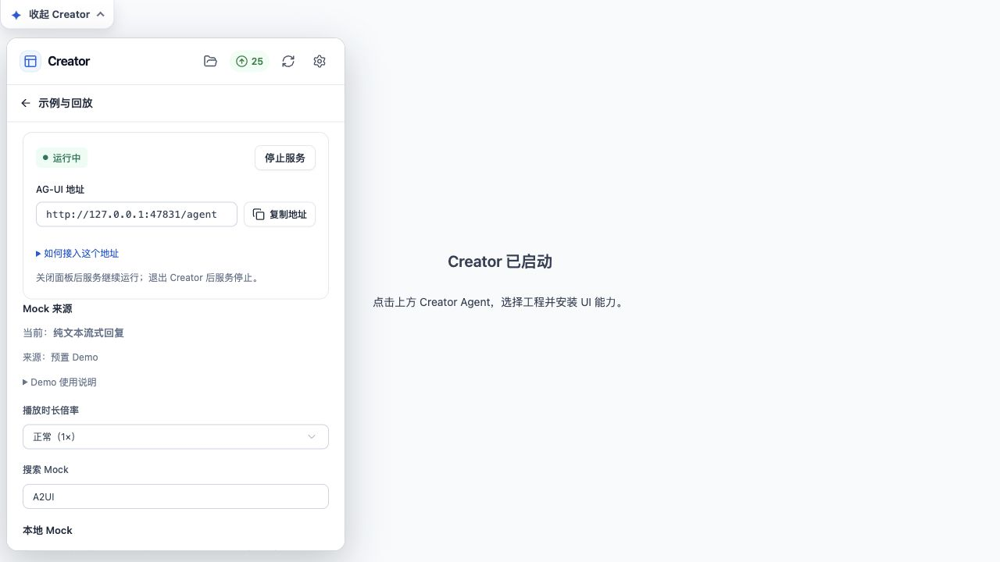

# A2UI 暂缓推出：实际界面验证

日期：2026-10-15。使用当前 dist 构建启动独立 Creator 工作台，目标项目为 creator-host-sandbox。通过真实浏览器操作主页面及 Creator iframe，无测试组件替身。

| 操作 | 实际结果 | 证据 |
| --- | --- | --- |
| 打开设置 → 示例与回放，检查完整预置列表 | 未出现 A2UI 表单和订单卡片 | 浏览器完整可访问性树 |
| 在搜索 Mock 中输入 A2UI | 显示“没有匹配的 Demo。”，没有对应安装按钮 | a2ui-search-empty.jpg |
| 搜索订单 | 没有匹配的 Demo | 浏览器可访问性树 |
| 搜索纯文本并选择示例 | 单选框选中；当前来源变为“纯文本流式回复” | normal-mock-running.jpg |
| 点击启动服务 | 显示“运行中”，分配实际 AG-UI 地址 | normal-mock-running.jpg |
| 搜索图表 | 其他图表示例仍可见 | 浏览器可访问性树 |
| 打开插件更新页 | 25 个现有插件更新项，无 A2UI 项 | plugin-updates-no-a2ui.jpg；iframe 可见文本检查 |

浏览器 error 日志为空。验证完成后通过界面停止本次 Mock 服务，并关闭本次临时工作台进程。

此验证确认实际界面的隐藏、选择和服务启动行为；未点击安装或升级按钮，未触发 Creator 修改应用源码，也未将其宣称为生成前端接入 Mock 后的完整对话验收。

