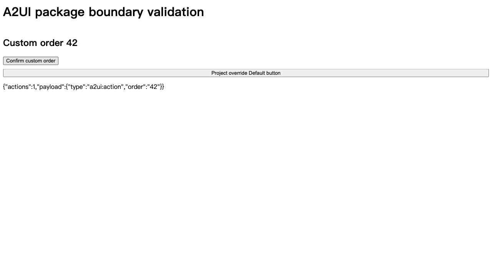

# 包内上游源码与选择性升级验证

> 历史实验记录：此验证之后 A2UI 已暂缓推出，相关演示和安装入口已屏蔽。下文 A2UI 验证及截图不代表当前发行可用功能。

日期：2026-10-15。以下为本地构建验证，未发布 npm，未提交或推送。

## 实际工程验证

`node scripts/verify-project-upgrades.mjs` 使用真实 Operator 构建产物、真实 Source Registry、临时目录和真实项目验证器，无 Mock provider / generator / verifier。

- assistant、embedded、platform 初始化后，工程中均无 vendor/vendors 文件。
- 官方 A2UI 资源安装及验证成功，工程无 vendor 文件。
- 模拟旧受管 vendor：本地修改时拒绝自动迁移并保留字节；恢复官方字节后迁移成功，旧文件删除，锁文件改为包桥接。
- 复制发布形态的 Registry 到不可变 Release 目录，两个插件均提供新版本，只选择 conversation-surface 升级；agent-identity 的源码字节和 source-lock 记录保持不变。
- 后续 Release 触发本地定制三方合并；禁止直接覆盖，通过 BASE/LOCAL/TARGET 合并并真实验证后推进基线，本地注释保留。
- 缺失历史 Release 时明确拒绝构造 BASE。

## 浏览器验证

实际浏览器加载 React 包构建入口及 CSS，输入原生 A2UI v1.0 createSurface operations：

- 新组件 OrderCard 显示订单 42。
- Button 被项目自定义实现覆盖。
- 点击 Confirm custom order 后显示 `{"actions":1,"payload":{"type":"a2ui:action","order":"42"}}`，未重复分发。
- 浏览器 error 日志为空。

此验证覆盖包入口、原生 A2UI operations、真实 React 浏览器渲染和 action dispatch；未声明真实 Agent 后端全链路验收。

## 自动检查

- React 相关测试 23 项通过。
- Operator 升级、迁移资源和 Windows 包调用相关测试 21 项通过。
- Registry release/provenance 4 项、Creator 更新 UI 2 项通过。
- 包职责 / pnpm 平台调用 6 项通过。
- React、Operator、Creator 类型检查通过。
- Source Registry 发布元数据检查通过；补齐前期公共包迁移后缺失的 27 个插件版本及 changelog 记录。
- i18n 中英文键一致，无失败；依赖固定版本检查通过。
- 实际 9 个 tarball 的严格消费类型检查、初始化和移除开发依赖后的独立生产构建通过。

额外运行的 React integration-boundary 文件有两项未通过：旧 AgentUIRoot 模板字符串断言，以及已有 tool-fallback 产品适配文件与生成器不一致。本轮没有修改这两处实现，未把它们算作本轮通过项目，也没有为通过断言覆盖工作区中的既有定制。

Windows 使用已有 Node path / POSIX 逻辑路径和 pnpm process helper；Windows 调用夹具通过，尚无真实 Windows 运行验收。

新增组件 Surface 使用上游公开 keepUnknownComponents 转换 API；其输入状态由自定义组件管理，不提供上游私有 native live-binding context。默认 Surface 保留上游原生绑定。完整扩展边界见架构说明。

## 后续 A2UI 暂缓检查

官方资源和两个内置 Mock 示例不再开放；直接 source 安装被拒绝；旧会话注册模块被跳过；专用渲染与动作桥接 API 不从当前发布包导出；旧服务返回的 A2UI 示例在面板内也被过滤。普通 JSON Generative UI 保留。

相关 catalog/API/生成注册表/兼容入口专项测试通过；源码资源、React、Operator、Creator 类型检查及构建通过；真实临时工程初始化、拒绝 A2UI 安装、单插件升级和三方合并通过。A2UI 正向功能测试作为延期功能保留并暂停，不计为通过。

另外运行的完整 MockServicePanel 测试仍有录制刷新和资源安装交互断言失败；这些测试未计入此次专项通过结论，未修改对应业务实现来迎合断言。

## 后续发布包排除检查

使用 `node scripts/verify-public-packages.mjs --strict-types` 实际打包并解开全部 9 个 npm tarball，确认：

- 无 A2UI 命名的模板、示例或 experimental 文件；Source Registry 的发布清单不含 integration/a2ui，也不带测试 fixtures。
- React 不导出 createAgentUIA2ui；Conversation Runtime 的公开声明不含 useConversationA2uiAction。
- Creator 不含两个 A2UI Mock 示例模块和安装指引，其他 skill references 仍存在。
- 发布包可正常加载 Registry、初始化工程，通过严格消费类型检查，并在移除开发依赖后独立生产构建。
- 真实临时工程的选择性升级及三方合并继续通过。相关类型检查、i18n 和 release metadata 检查通过。

Windows 路径/调用夹具通过，尚未实际在 Windows 打包运行。该检查排除的是自有 A2UI 产品内容；不声称上游 npm 依赖和协议兼容类型中完全没有 A2UI 字符串或底层支持。未发布 npm。
