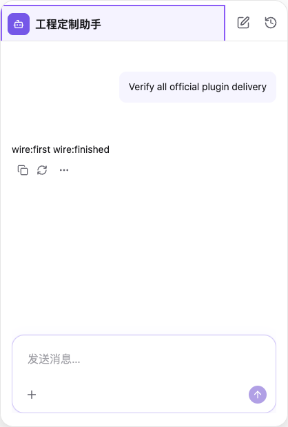

# 第九批：全部现代官方插件交付

本批补齐剩余 16 个现代官方插件，完整清单见 [inventory.json](inventory.json)。现在 44 个现代官方插件均支持 npm 默认引用、工程薄应用层 props/组合、明确确认后的精确版本接管，以及 Creator 更新页的实现源码同步。19 个历史 assistant-ui-* 资源继续兼容；不自动迁移或重写用户旧源码。版本仍为未发布的 0.0.1。

## 实现和所有权

- Host 绑定模板由实际安装 catalog 声明，路径、SHA、重复目标与符号链接检查后事务初始化；重复执行保留已有应用层。身份 config、认证 adapter、服务连接参数在应用层。
- 六个 provider 通过 bindSetup 绑定现有 Host 的服务上下文，保留其扩充类型、生命周期和 cleanup。未绑定时失败，不创建第二份 Context 或 Runtime。主题、locale、认证 helper 来自唯一插件适配 owner。
- auth-account/auth-gate 共用的 services/auth/session.ts 声明仅在缺失时初始化，现有文件不覆盖，后续 source-only 合并不管理它。Host 用户（包括 null）优先，认证仍由工程配置真实 adapter。
- Surface、task-group、message-footer 从 Host 接收现有 adapter、scope 和语义 Slot；支持 props/renderer/children，原有 Runtime、注册、布局和回退不变。
- Lexical 插件保留可选 /lexical 边界，透传原生 input/composition props，类型与 pinned upstream 双向检查。输入、提及、命令、编辑提交/取消、引用与不支持指令的 textarea 回退均有覆盖。
- 接管只机械切换应用静态 import；BASE/LOCAL/TARGET 只管理 source/。应用层 CRLF/注释/props、额外 config、插件/实例 ID、AppUIModel、已有源码及 CSS/helper 定制独立保留。

完整公共 API 审计、旧工程自动分层迁移不属于已完成范围；不能把全部插件接入等同于已经逐项审计全部上游参数。

## 验证

相关测试共 **547 项通过**：Plugins 165 项（11 文件）、Operator 189 项（6 文件）、Creator Python 193 项（4 文件）。生命周期覆盖全部 43 个非 Composer 现代条目，Composer 沿用既有专门机制与回归。包含 npm/portable 实际组件交互、旧目录有/无 lock、合成版本升级、冲突合并、应用层字节和额外配置保留、模板完整性及绑定合同保护。Creator 使用实际 LangGraph 中断和恢复覆盖全部新 ID 的同意/拒绝、权限与更新边界；不是外部模型验收。具体命令、数量与边界见 [validation.json](validation.json)。Plugins/Operator 的 build、typecheck、i18n（failures=[]）、upstream guard、公开声明边界（301 份）和 diff 检查通过。

[tarball.json](tarball.json) 对实际 npm tarball 验证了全部 exports 目标、44 个现代入口、45 个 portable closure、540 个 canonical snapshot、512 个 portable/runtime 摘要，以及 36 个应用模板/共享声明摘要。theme/theme-contract.d.ts 保留，无 tests/node_modules。没有发布 npm。

Windows 逻辑路径、drive/UNC/中文空格路径与 pnpm 调用用例执行；没有原生 Windows 验收。升级使用临时合成 0.0.2，未使用已发布的新上游版本。源码托管不冻结共享 npm 底座的行为。

旧 fixture 修复继续暂停，没有跑全量旧 fixture。此前记录的 Composer Node 包边界检查 chart-message 进入依赖图问题仍未解决，见 [前批诊断](../conversation-plugin-delivery-2026-10-17/package-boundary-diagnostic.json)；不宣称全量检查通过。

## 真实生成 Host 与截图

[脚本](../../../scripts/verify-all-official-plugin-delivery.mts) 使用实际初始化的 assistant Host 和当前构建包，[结果](browser.json) 记录：

1. 初始化并验证全部 44 个薄应用层标识，生成实际 registry；重复初始化不覆盖定制。
2. 在身份插件薄层传入工程自定义名称、8px padding、边框与背景，通过本地 HTTP AG-UI 服务发送并显示消息。
3. 使用真实 Operator 接管 agent-identity、conversation-surface、theme-provider，验证应用 import 切换、config 与 AppUIModel 保留，并对暂存定义执行 Vite 构建。
4. 修改工程内的身份/Surface 实现 DOM 标记和主题 helper，重载确认本地实现实际渲染、薄层定制保留，provider setup 仍执行，再发送消息成功，pageerror=[]。

npm 默认引用加薄层 props：

接管后本地实现生效，保留相同工程定制：

这是生成 Host 的真实页面，未调用外部模型；浏览器直接调用 Operator 接管，不是 Creator 外部模型对话的完整实跑。Creator 原生确认的 LangGraph 中断、同意/拒绝恢复与权限边界由 Python 用例覆盖。截图中的两种模式保留同一视觉定制，本地源码生效另由 DOM 标记断言验证。Vite 可选 react-lexical 预构建提示仍存在；浏览器两轮消息均成功。

后续已完成 Composer 代表性真实 Creator / 外部模型完整旅程：props、原生确认、源码修改、候选包升级及冲突合并，应用层和已有定制保留，详见 [独立验收记录](../creator-live-final-acceptance-2026-10-17/README.md)。这不扩展为全部 44 个插件分别完成真实模型验收。
