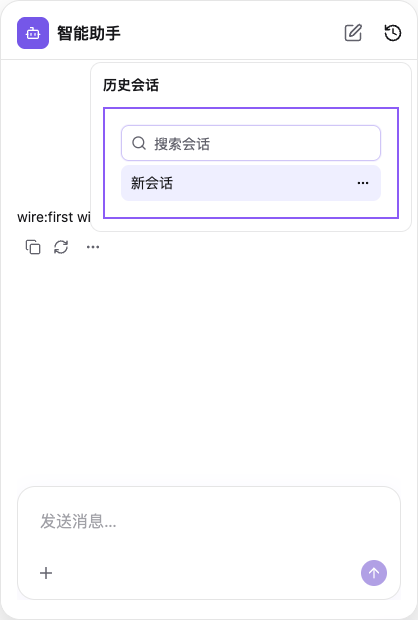
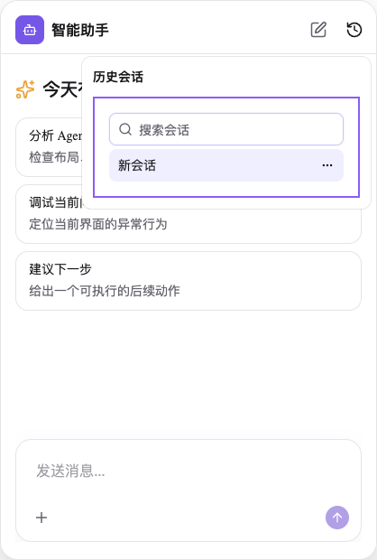

# 第八批：会话列表、历史、新建与引用回复

本批接入 `conversation-thread-list`、`conversation-history`、`conversation-new`、`conversation-quote`。现代 npm 入口合计 28 个，另有旧 Composer 兼容入口；剩余 16 个现代资源见 [inventory.json](inventory.json)。包版本仍是未发布的 0.0.1。

四个插件默认在工程薄应用层引用 npm。先用 props、children、renderer 和组件组合定制；只有用户同意接管后，才提取实际安装版本的源码并机械切换 import。实现同步仍走 Creator 更新页的 source-only BASE/LOCAL/TARGET 合并。应用层、插件/实例 ID、配置、已有源码与 CSS 定制保持独立。

## 实现边界

- 会话列表：root/list/new/search/item props、行组件替换和 children。原有分组、搜索、禁用策略、加载错误和重试保留。
- 会话历史：root/trigger/popover/content props、受控与默认展开、children，以及原有 content 语义 Slot。会话变化通过原生 close action 关闭，保留 onOpenChange 和原生事件取消行为。
- 新建会话：root/new/tooltip/content props、children；继续使用共享上游的新建动作，尊重 preventDefault，不引入另一套会话生命周期。
- 引用回复：preview/toolbar props、renderPreview/renderToolbar、children；继续使用共享选择、预览、清理与发送上下文。尚未宣称已完成整个上游公共 API 的逐项审计。

交付清单新增 hostBindings 和 railAction：薄层读取现有 Host conversation service、theme/run Context，通过 props 供 npm 或本地实现消费；不复制服务、Context 或 Runtime。列表的 RailAction 在 npm、应用层和源码入口中都保留。应用合同摘要绑定这些字段，旧条目没有新字段时摘要保持原值；不兼容目标必须另行迁移应用层。

各插件展示实现只有一个 canonical owner。旧资源入口保留 Host 绑定和历史导出，转发到同一展示实现。图标通过已有 plugin-support 共享接口获取，portable source 不隐含依赖用户另装 lucide-react。conversationQuote 和 threadList 的历史标题/重试键进入统一 locale，保留既有 Host 覆盖，中英文一致；vendor 未修改。

本批没有为 platform 添加另一套会话导航或重新安排布局。history/new 沿用 assistant 模板已有页头位置；已有定制旧目录依然优先，不自动迁移、复制或改写。

## 自动验证

相关 Vitest / Python **357 项通过**，去重计算：

- Plugins 80 项，11 文件。新批次覆盖 npm 与实际 portable snapshot 两种模式的 props、搜索、禁用、选择、新建、错误重试、弹层受控/默认状态与事件取消、语义 content Slot、locale 和覆盖；引用测试对原语、npm、portable 三种实现验证实际选择/取消/发送、会话切换与卸载清理、引用历史还原。另保留前几批 props、消息、locale 回归。
- Operator 132 项，6 文件。121 项整组回归通过，另有目录/服务元数据 11 项。覆盖全部 27 个非 Composer 现代插件的接管、合成 0.0.2 包升级、冲突合并、应用层字节与配置保留、旧目录有/无 lock 定制保留，以及 Host 绑定/RailAction 不兼容拒绝。最终四个新 ID 的 15 项生命周期/保护用例另行重跑通过，未重复计数。
- Creator Python 145 项，4 文件。包括四个新 ID 的实际 LangGraph 询问中断、同意/拒绝恢复、写入权限、更新与完成刷新边界；不是外部模型的端到端验收。

Plugins / Operator build、typecheck、i18n（failures=[]）、upstream guard、公开声明边界 173 项及 diff 检查通过。Windows 相关逻辑路径/drive/UNC、中文空格工程路径及进程调用用例执行；没有原生 Windows 验收。

[tarball.json](tarball.json) 记录实际打包验证：28 个现代入口、29 个 portable closure、450 个 canonical snapshot、329 个 portable/runtime 摘要及所有 exports 目标均核对。三份 CSS/声明、theme/theme-contract.d.ts 存在，没有 tests/node_modules 混入。没有发布 npm。

## 已知未解决检查

额外执行的 Composer Node 包边界检查为 **1 通过、1 失败**：`Composer subpath imports independently and Vite graph contains no other official plugins` 报 `chart-message entered bundle graph`。在临时 Vite transform 中移除本批所有四插件的 public 导出后，依然能复现图表模块进入依赖图，见 [package-boundary-diagnostic.json](package-boundary-diagnostic.json)。本轮未修改该检查，也不宣称所有检查或全量测试通过。旧 migrated fixture 与历史 fixture 没有修复或跑全量。

## 真实生成工程与截图

运行 [验证脚本](../../../scripts/verify-conversation-plugin-delivery.mts)，结果见 [browser.json](browser.json)：

1. 用真实初始化的独立 assistant Host、当前构建包创建四个薄层，确认 application.json 与 npm 入口；重复初始化保留已有应用层。
2. 在列表薄层传 aria/style props，打开真实历史弹层，确认 16px padding。
3. 通过本地 HTTP AG-UI 服务发送一轮消息并完成渲染。
4. 真实 Operator 提取当前版本列表源码，切换静态 import；应用层仅 import 改变，AppUIModel 字节保持，RailAction 保留。
5. 修改临时工程中的本地实现 DOM 标记，重载后确认本地实现生效、16px 样式保留、pageerror=[]。

npm 薄层定制：

接管后保留相同定制：

这是生成 Host 的真实浏览器页面；不是单独演示页，也不是外部模型完成的 Creator 对话。浏览器脚本直接调用 Operator 应用接管计划；确认中断由上述 Creator 测试覆盖。页面重载使用 fixture 的临时会话服务，不证明服务端持久化历史。Vite 的可选 react-lexical 预构建提示仍存在。

升级目标是临时合成的 0.0.2，不是真实上游/npm 新版本。共享 API/Runtime 的后续兼容性仍须验证；源码托管不冻结共享底座行为。
