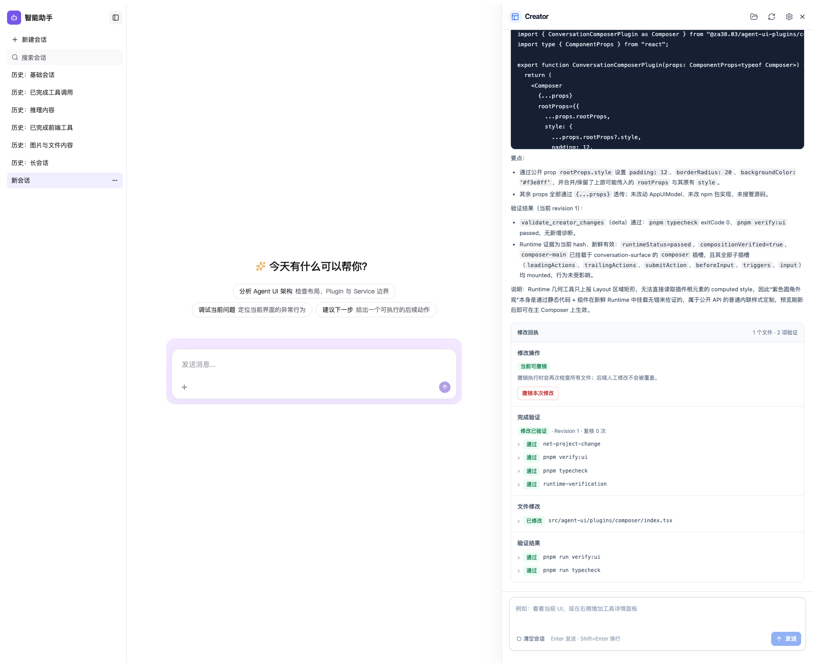
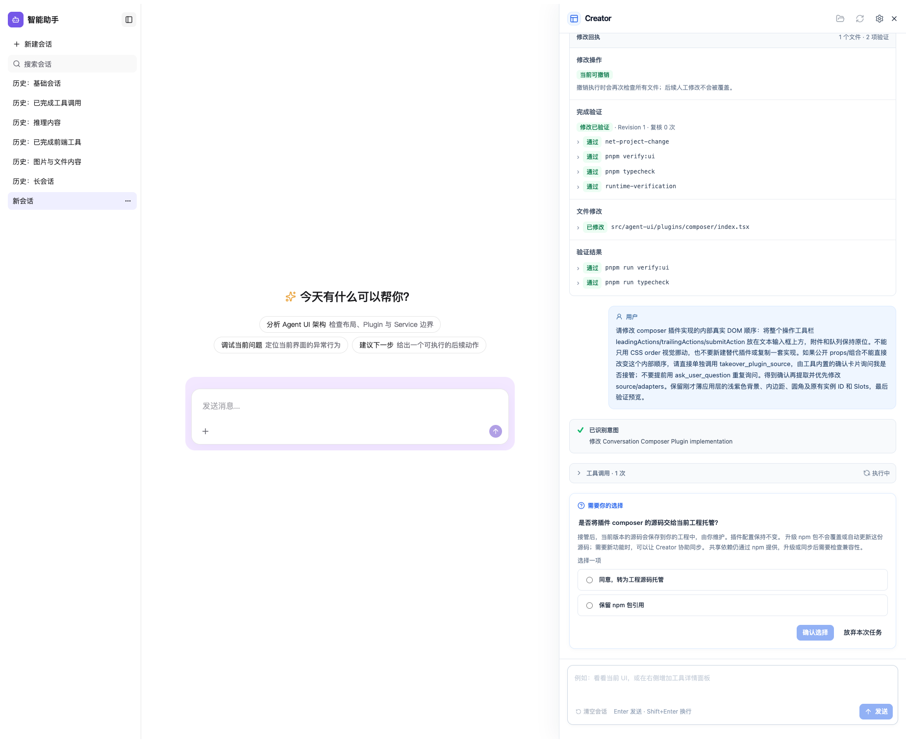
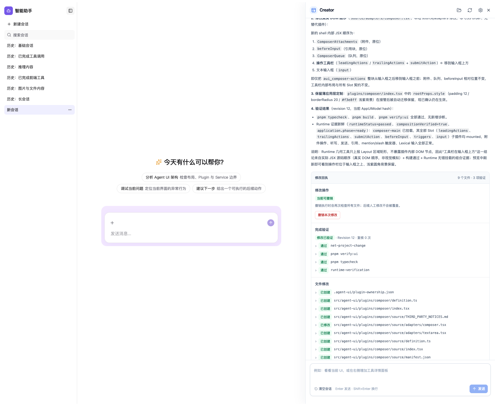
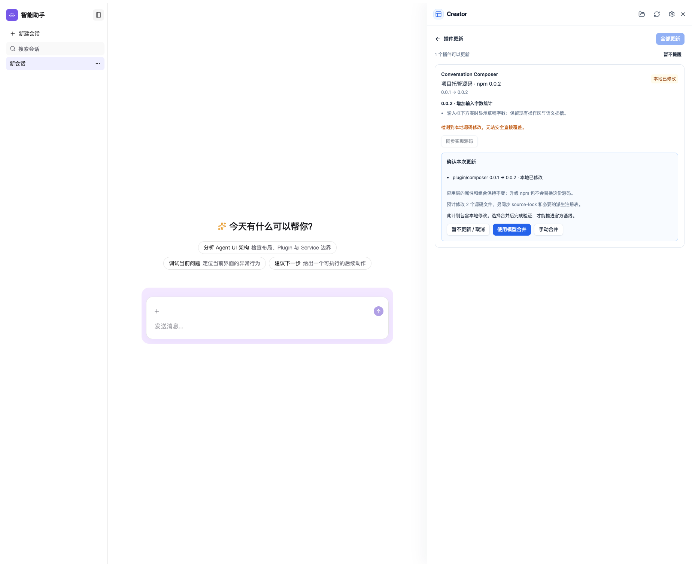
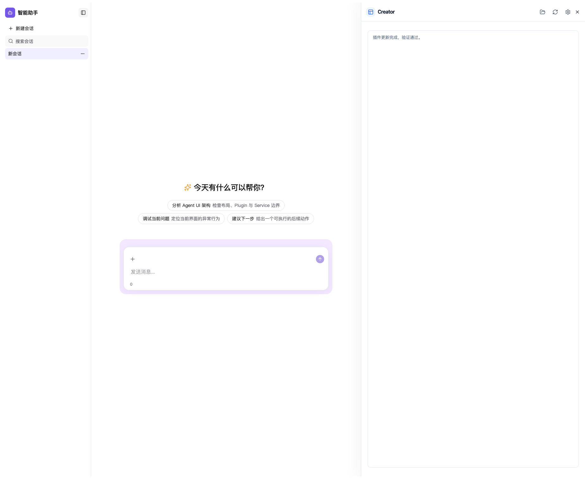
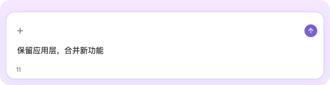

# 真实 Creator / 真实模型完整验收

2026-10-17，以全部 44 个现代官方插件接入后的当前工作区代码，重新构建 Creator 和 Plugins 本地候选包，在同一独立 Host 工程、同一个 Creator 会话中完成全部流程。Creator 使用 Host 已配置的真实外部模型，没有替换模型响应或 Creator 页面，没有由测试脚本代写工程内的 props/实现/合并结果。

结果：**本轮完整通过**。4 次真实 run 请求依次是 props、接管询问中断、用户批准后恢复与修改、更新页模型合并；无 RUN_ERROR、无协议重试、无人工代改源码。证据为 [verification.json](verification.json)、[preservation-proof.json](preservation-proof.json)、[完整 SSE](creator-runs.json) 和 creator-logs/。

## 验证流程与截图

1. **只改 props，不接管。** 模型在 Composer 薄应用层设置 12px padding、20px 圆角和浅紫背景，保留原有 props/Slot。确认 ownership 与 source/ 均不存在，实际 computed style 生效。

   

2. **公开属性不能满足内部结构调整时，先询问。** 请求将操作工具栏的真实 JSX 移到输入框上方。Creator 调用原生 takeover_plugin_source，中断呈现确认卡；回答前没有 ownership。卡片说明维护责任、npm 升级不覆盖本地源码、后续同步及共享依赖兼容性，没有展示内部路径或哈希。通过实际 UI 选择同意后恢复。

   

3. **提取准确版本并修改源码。** Operator 提取已安装 0.0.1 的闭包；模型修改 source/adapters/composer.tsx 内部 DOM 顺序。薄应用层仅 import 从 npm 改为 ./source/index，其他字节相等；浅紫背景、padding、圆角与所有 Slot 保留。工具栏下边界 y=840，输入框顶边 y=848，实际 DOM 和几何均为工具栏在前。

   

4. **升级整个 Plugins 包，不覆盖托管实现。** 本地候选包从 0.0.1 更换为 0.0.2 并更新工程依赖声明，更新前后断言应用层、ownership/BASE 和已托管实现字节不变。候选版在官方同一 Composer 源文件增加实时字数统计，与本地顺序修改形成 BASE/LOCAL/TARGET 三份不同内容。更新页真实显示已托管状态及版本，计划 requiresMerge=true。

   

5. **模型合并后，显式验证和推进基线。** 在真实更新页点击“使用模型合并”，模型将新版统计与本地工具栏顺序合并。返回更新页点击“我已完成合并：验证并推进基线”，收到更新成功。采用后的 BASE 等于官方 TARGET，仍与本地定制实现不同；BASE 的六个条目全部在 source/ 内。更新页最终显示当前/目标 0.0.2、customized、updateAvailable=false。

   

6. **最终页面保留旧定制并具备新功能。** 工具栏仍在输入框上方（底边 y=820、输入框顶边 y=828）；背景、padding、圆角完全一致。输入“保留应用层，合并新功能”，字数统计实时显示 11。

   

## 保留与完成证据

- 应用层 SHA-256 升级/合并前后均为 ef43eb6a1a24c7e930edd4f2e64c8b6dca26927222431f35562e7a293dcd212b；最终应用内容与 props 定制后仅替换 import 的预期逐字节相等。
- definition 和 AppUIModel 保持原字节；插件 ID、实例身份、原有配置和 Slots 保留。
- props、takeover、source-merge 三个完成回执均为 changed-and-verified，runtime-verification 均为 passed，见 [Runtime 回执](runtime-completion-verdicts.json)。当前 Runtime 通过并不替代视觉断言；本轮另外验证了 computed style、DOM 顺序、几何位置和实时输入统计。
- Host 最终 verify:ui、typecheck、Vite build 均 exit 0；构建执行真实 write:false 内存构建，日志为 final-verify-ui.log、final-typecheck.log、final-build.log。verify:ui errors=[]，仍有 5 条 CREATOR_ADD_RESTORE_UNAVAILABLE 提示（部分插件未声明确定的 Add/Restore placement），本轮未修改。
- 浏览器 pageerror=[]。合并时 manifest 版本变化曾引起一次 stale manifest metadata Runtime 诊断，注册表重同步后自行恢复并标记 resolved，最终没有未解决 Runtime 错误。替换 npm 目录时有 Vite Fast Refresh 失效/重载日志；最终页面、构建与当前 Runtime 验证均通过。
- Creator build、预览验证代码 typecheck、git diff --check 通过。验证 Host 的内存构建脚本原有一条无效且未使用的相对 import 已移除；没有修改旧 fixture 测试案例，没有跑旧 fixture 全量回归。

## 边界与复现

本轮是 **Composer 代表性完整旅程**，不是对 44 个插件分别进行真实模型完整验收。预览 Agent 数据服务仍是本地测试 Host；真实外部模型用于 Creator 编码、接管后修改和冲突合并。没有伪装成真实生产 Agent 后端。

升级使用两份真实构建的本地 npm tarball，见 [候选包版本与摘要](candidate-packages.json)，未发布公网。独立临时工程通过提取 tarball 替换其实际解析的包目录并更新依赖声明来模拟安装升级，未声称执行过公网 pnpm install。工作区官方版本仍为 0.0.1，候选统计功能没有写入工作区官方实现。

入口为 [捕获脚本](../../../scripts/capture-creator-final-acceptance.mts)，先用 [候选包准备脚本](../../../scripts/prepare-composer-live-release.mts) 构建两个版本，再传入生成的 releases.json。使用现有跨平台 pnpm helper、fileURLToPath、native path 和 Windows junction 分支；本轮在 macOS 执行，没有原生 Windows 验收。浏览器、Python sidecar 与临时 Host 已在成功后关闭并清理，记录和最终源码保存在本目录。
