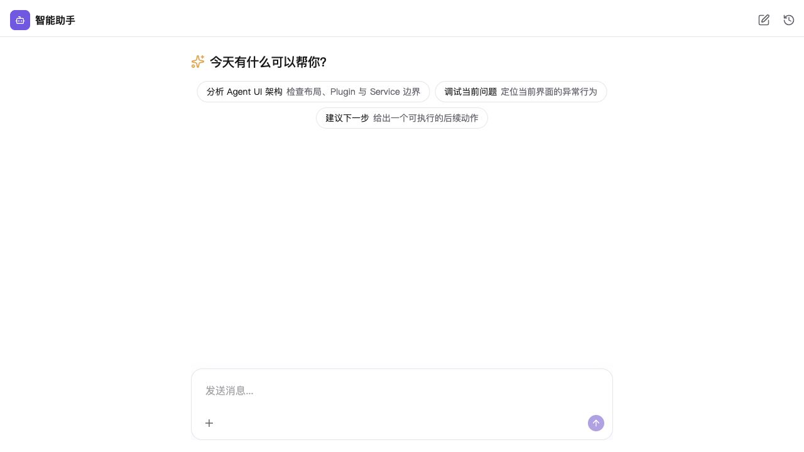
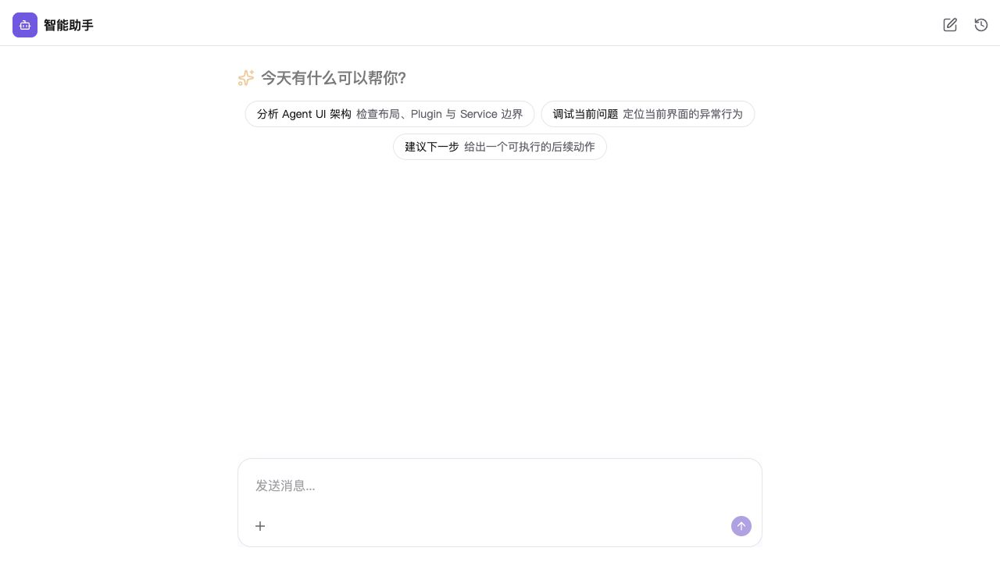
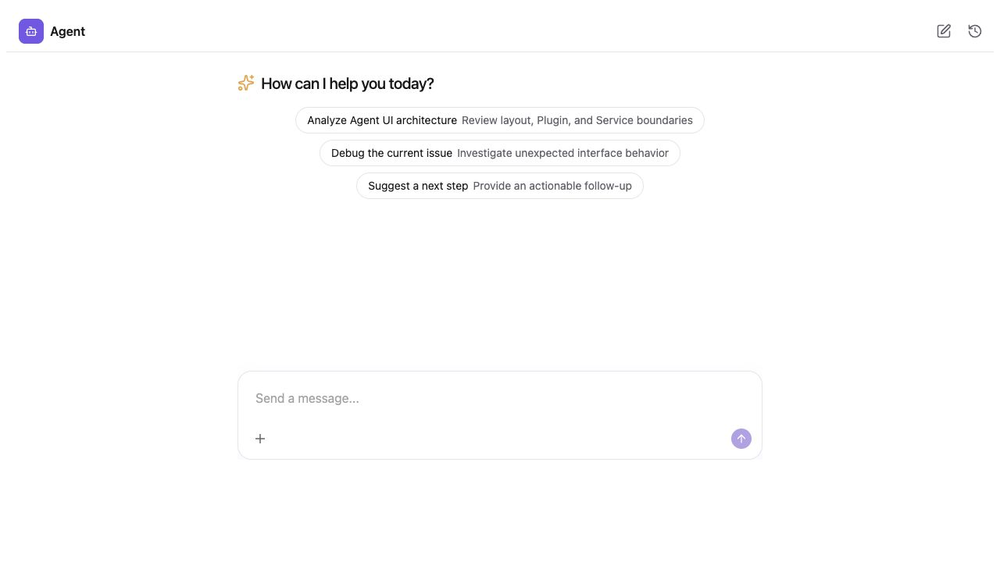
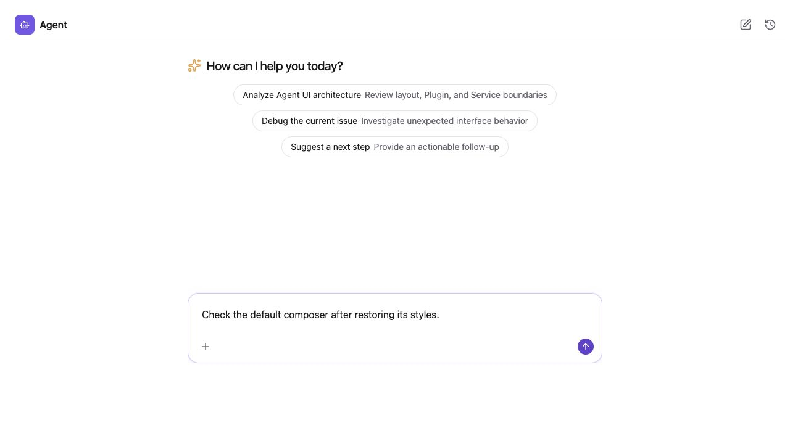
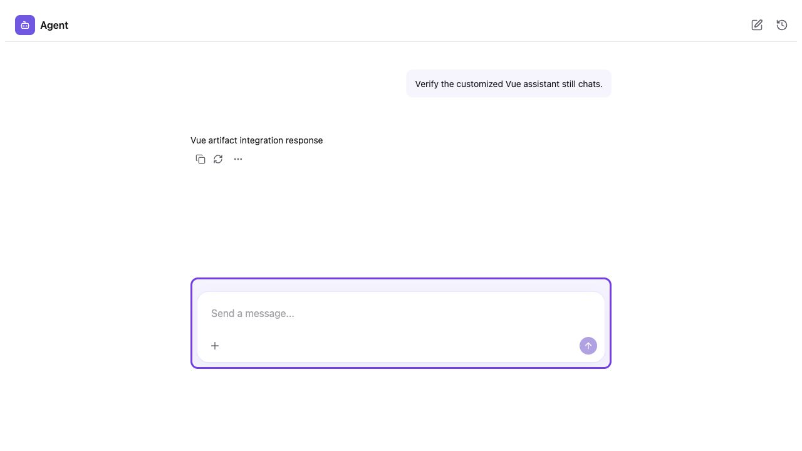
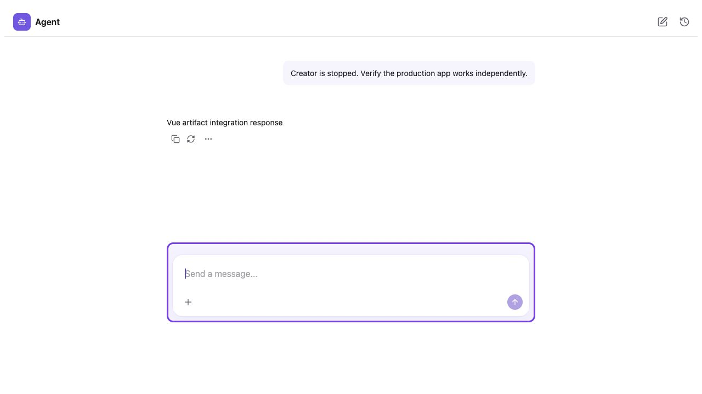

# Vue 独立生产工程与定制产物关联验证（2026-10-18）

本轮补齐 Vue 初始化分流、关联 React 生产工程及其定制产物发布。全新 Vue 测试工程已完成实际安装 → 初始化 → 确认接入 → 真实 Creator 定制 → 界面构建发布 → Vue 页面聊天 → 脱离 Creator 独立构建运行的完整流程。

## 后续输入框样式修复

### 默认字体与展示配置统一（最新结果）

已把 Shadow 挂载层的字体改为与原生 React 相同的宿主继承方式，保留官方展示与业务 Plugin 的字体边界。挂载样式由公共 Host 工厂统一维护，不再在 standalone 与项目 Bridge 各留一份。Web Component 默认高度从固定 600px 改为 100dvh，宿主可显式设置元素高度；两边都支持 `--agent-ui-height`。生成的独立 React 预览默认去掉 body margin 并填满视口，现有业务页面的边距由宿主决定。

Web Component 从 producer 自己的 locale-config/theme-config 读取默认值；接入配方不再强制英文或紫色覆盖项目设置。显式属性/配置继续优先，旧 wrapper 中已经写明的选项会保留。本次在临时 Vue fixture 中明确移除旧 wrapper 的语言/主题覆盖，并把两个测试宿主的页面边距统一为 0。

实际重新构建、打包并安装 Plugins/Web Component tgz，更新项目 Bridge 入口，再构建发布及 Vue 生产构建。新截图 `09-react-unified-defaults.jpg` 与 `10-web-component-unified-defaults.jpg` 使用无 locale 参数的原生 Agent 和无 locale/theme 覆盖的真实 Vue 嵌入，两边均为项目默认中文/violet，1280×720 视口。146 个后代节点的结构与边界矩形全部对应一致，字体计算属性无差异；剩余只有无背景图时 `0% 0%`/`0px 0px` 的表达与阴影颜色浮点末位序列化差异，详见 `unified-presentation-comparison.json`。

额外测试宿主字体 Georgia/18px、420px 区域，两边都保留该字体且实际高度为 420px；Web Component 显式英文/dark 覆盖仍生效，见 `presentation-overrides.json`。Web Component 10 项测试、Operator 15 项测试、Plugin 样式隔离 2 项测试、类型检查、正式构建和 standalone/ESM distribution 检查通过。未做 Windows 实机运行；变更没有新增路径或进程假设。聊天使用既有本地 AG-UI SSE 测试服务。

### 整体视觉对照补充

继续对照发现，上述输入框属性一致不能外推为整页视觉一致。原 React 测试页面使用中文和 704px 可用高度；Web Component 使用英文和默认 600px 高度。React 的宿主字体为 PingFang SC，Web Component 挂载层设置为 ui-sans-serif/system-ui/sans-serif。语言、容器和字体来源的差异会改变换行与留白。

使用同一份生产工程，额外建立仅用于对照的 React 入口，统一英文、violet 主题、600px 容器，浏览器窗口同为 1280×720。对照整页截图 `07-react-equal-conditions.jpg`、`08-web-component-equal-conditions.jpg`。146 个后代节点的 tag/class 对应一致，仍有 font-family 及其衍生字宽/字高差异，另有 background-position 表达和阴影浮点序列化差异。不能将这次结果称为像素级一致；字体继承/隔离策略与默认容器、locale 需作为明确的接入配置处理。本次分析未擅自改写宿主字体或嵌入高度。

用户反馈后，已移除临时测试工程 Composer 应用层的紫色容器，恢复原始 npm Composer 透传。以下旧流程的紫色截图只作为当时验证定制发布的历史证据，当前预览已更新为默认输入框。

确实存在 Web Component 的样式初始化缺口：同一应用在 React 文档中为 `1px solid`，嵌入 Shadow DOM 后 `--tw-border-style` 为空，计算出的边框为 `0px none`。这不是 Vue 改写组件造成的；项目构建的 Bridge 使用自己的样式输入，未获得 standalone CSS 中原有的部分 shadow/ring 默认值，且这些默认值也没有覆盖边框。

修复在公共 `createAgentUIElement` 工厂中注入低优先级、仅作用于 Shadow DOM 挂载子树和伪元素的边框/轮廓及 shadow/ring 初始变量。standalone 与 project-built Bridge 共用这份初始化，utility 与应用自定义样式仍可覆盖；不注入宿主 document 样式，也不修改 vendor 或默认输入框设计。移除 standalone 样式中的重复旧默认值。

实际重新构建 Web Component npm tgz，安装到测试 producer，再通过 Operator 构建发布及 Vue 自己的 build 更新生产页面。修复后与 React 对照：边框 `1px solid oklch(0.922 0 0)`、背景白色、圆角 18px、内边距 10px 12px、宽 672px、高 114px 均一致；阴影仅序列化浮点末位存在差异。聚焦阴影正常、紫色测试容器数量为 0，消息发送和本地 SSE 回复通过。

Web Component 全部 8 项单元测试、类型检查、正式构建及 standalone/ESM distribution 检查通过。新回归覆盖项目自带样式时仍初始化变量。此修改只有浏览器 CSS/TypeScript，无新增原生路径或进程处理；未做 Windows 实机验收。

## 真实用户流程结果

1. 在仅有 Vue 生产依赖的全新工程安装并启动实际打包的 Creator。界面识别 Vue，展示独立工程目录与安装计划；点击确认后，在 `agent-ui/` 安装 React 与 Agent UI 依赖并构建，而不是给 Vue 宿主安装 React。
2. 复制界面显示的接入提示词，先请求只读方案，再确认接入 `src/App.vue` 的 main 区域。真实模型通过 Host 工具创建 Bridge 与挂载入口，4 项静态检查全部通过，正常结束请求。浏览器虚拟剪贴板未读到系统 clipboard 内容，因此测试输入采用界面显示的原文；复制按钮显示“已复制”，精确 writeText 参数另有定向测试覆盖。
3. 重启实际安装的 Creator，Vue 身份与关联工程仍保留。向 Creator 请求仅修改 Composer 应用层，在 npm Composer 外加紫色边框容器。模型实际写入一个文件，保留 props 透传，没有接管实现源码；Operator 规范校验与 npm typecheck 通过。
4. 定制后尚未发布时，接入计划返回 `module-required`，拒绝把旧产物当作当前源码结果。点击界面“构建并更新到宿主”，出现“已更新宿主产物”。新 bundle 与 producer 输出、Vue 的 public 文件及最终 dist 文件哈希一致，且不同于初次构建。
5. 使用 Vue 自己的 `npm run build`，打开静态生产页面。浏览器确认 Web Component Shadow DOM 内边框为 `3px solid rgb(124, 58, 237)`、背景 `rgb(245, 243, 255)`、圆角 12px、内边距 8px；实际发送消息并收到 SSE 回复，浏览器未记录 error。
6. 停止 Creator，临时移走测试宿主 node_modules 中的 Creator 与 Operator 包。独立工程的 typecheck、test、build 和 Vue 宿主 build 均通过，之后恢复开发工具包。这里生成工程的 test 脚本是 TypeScript 检查，不代表额外单元测试。Creator 保持关闭，刷新生产页面后仍可发送并收到回复。

宿主 package.json、package-lock.json 与 src/main.ts 均与初始化前一致；宿主生产依赖仍只有 Vue。独立工程没有 Creator/Operator 依赖，生产 bundle 无这些包名。项目应用层已定制，source-lock 哈希保持不变。

生产页面预览：<http://127.0.0.1:5203/>（本地临时测试进程）。

原始证据：`accepted-creator-transcript.txt`、`accepted-publication.json`、`accepted-stale-recipe.json`、`accepted-independent-build.json`、`independence-and-preservation.json`、`accepted-agui.jsonl`。

## 实现范围

- Vue 首次设置生成独立 Agent UI 工程与依赖安装计划，用户确认当前计划后安装。默认目录 agent-ui，禁止放入 src/public 等宿主编译或静态资源目录；共享 workspace、yarn/bun 自动初始化尚不支持。
- 宿主开发配置 .agent-ui/producer.json 与生产工程 .agent-ui/consumer.json 形成双向相对路径关联。Creator 保留 Vue 宿主身份，代码编辑、源码更新与运行控制面使用 React 生产工程。
- 使用现有 Bootstrap 与增量资源安装机制初始化官方源码及 bridge。没有新增 Runtime，也不自动接管 npm Plugin 源码。
- “构建并更新到宿主”构建关联工程，检查源码/配置/锁文件与宿主上次发布的哈希，再更新 public/agent-ui.js。绑定工程不退回官方默认资源；原始应用层与 source BASE 不因构建发布被覆盖或推进。
- 真实模型转交长 JSON 时丢失末尾换行，原 Host 校验正确拒绝。本轮增加 request-local recipeReference：通过计划 ID 取回原始 Host 配方，完整配方输入仍原样验证，不放松验签或冲突检查。
- 绑定宿主的操作依赖 Host 配方回执，不把宿主路径冒充为生产工程路径用于源码撤销。

## 验证环境与限制

首次安装与新生产工程使用实际 npm 安装，node_modules 均无 workspace 链接。七个第一方包来自实际 tgz，本地 scoped npm 测试 registry 只提供这些真实包；没有公开 npm 发布，也没有替换 Creator 模型或伪造工具结果。Vue 宿主测试使用 Vue 3.5.42、Vite 8.3.0、plugin-vue 6.0.9（原旧 fixture 的 plugin-vue 6.0.1 与 Vite 8 声明不兼容，因此为本轮全新测试工程选用已安装元数据声明兼容的 6.0.9；未改旧 fixture）。

聊天的 AG-UI 后端是本地 HTTP SSE 测试服务，不能代替真实 Agent 后端验收。没有 Windows 实机验收；路径测试覆盖 Windows 驱动器/UNC/反斜杠输入，进程执行复用现有跨平台 package-manager helper。

## 已执行静态与定向验证

- Operator 与 Creator 正式构建、打包通过。
- Operator 初始化/发布与接入配方：15 项通过。
- Creator 工作区路由/API/引导交互：26 项通过。
- Python 接入工具、完成判断及独立工程验证：7 项通过，覆盖原始配方字节保留、未知引用拒绝和跨工程活动记录边界。
- Creator 类型检查、i18n 检查通过。
- 实际安装包的 Operator /host 新 API 使用 NodeNext、skipLibCheck=false 的独立类型检查通过。

## 扩展恢复测试边界

扩展运行 recovery completion 测试时，两项 scripted-model 用例因旧 mock 的
SimpleNamespace Operator 缺少 inspect_ui_project 接口而失败。内存中禁用本轮
bound-host 完成分支后，单独重跑同两项仍然以同样接口缺失失败。未改旧 fixture，
不将这部分报告为全仓库测试通过。

完成判断只对本轮实际 Host apply/verify 回执、通过的检查、匹配 revision 且没有
本地源码改动/Plugin 开发委托的情形生效；源码修改仍走原有验证。独立生产工程缺少
verify:ui 脚本时，由 Operator 执行规范校验；现有自定义脚本优先，避免给生产工程
增加 Creator/Operator 依赖。
