# Demo 逐项修复与实际截图

日期：2026-10-13。验收页面：http://127.0.0.1:5176/；控制页面：5174/dock.html。macOS、IAB 1280×720、紫色主题。按问题依次修复并截图，没有修改 vendor。本轮没有执行提交或推送；截图与日志记录实际验证状态。

## 对比

### 01 网页搜索完成态空白

完成后去掉占位最小高度，搜索进行中保留占位。

修复前：

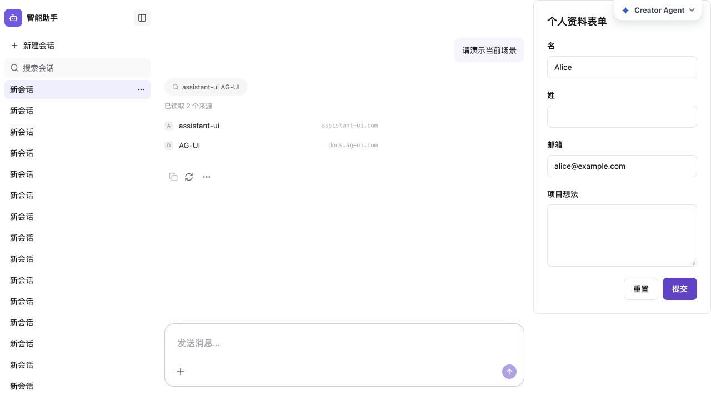

修复后：

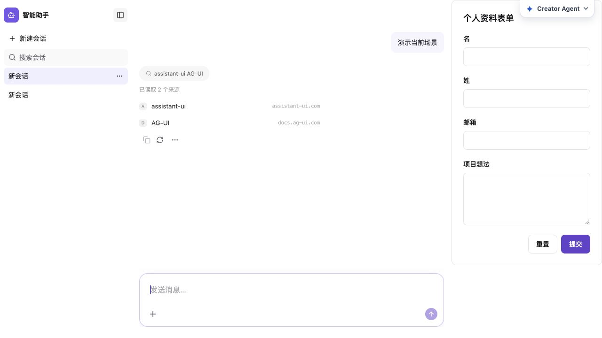

### 02 两个刷新恢复 Demo 回到欢迎页

Host 开发态保存当前会话并接入现有 run-resume；Mock 会话接口提供原运行历史。实际刷新后续接原 run，验证时 runCount 均为 1；最后一次长任务复验记录见 final-durable-runs.json。

修复前：

修复后：

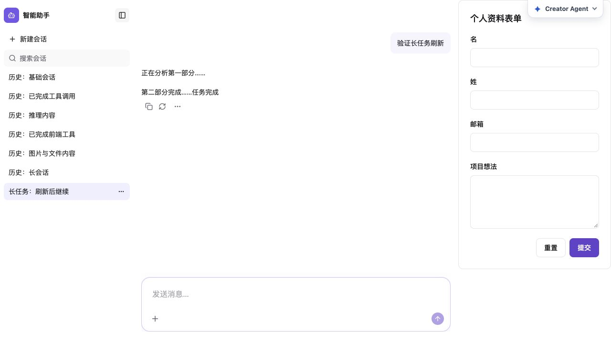

最终版本重新刷新长任务，也成功继续原运行：

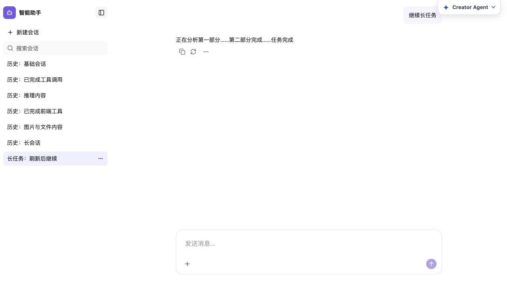

执行计划刷新恢复：

修复前：

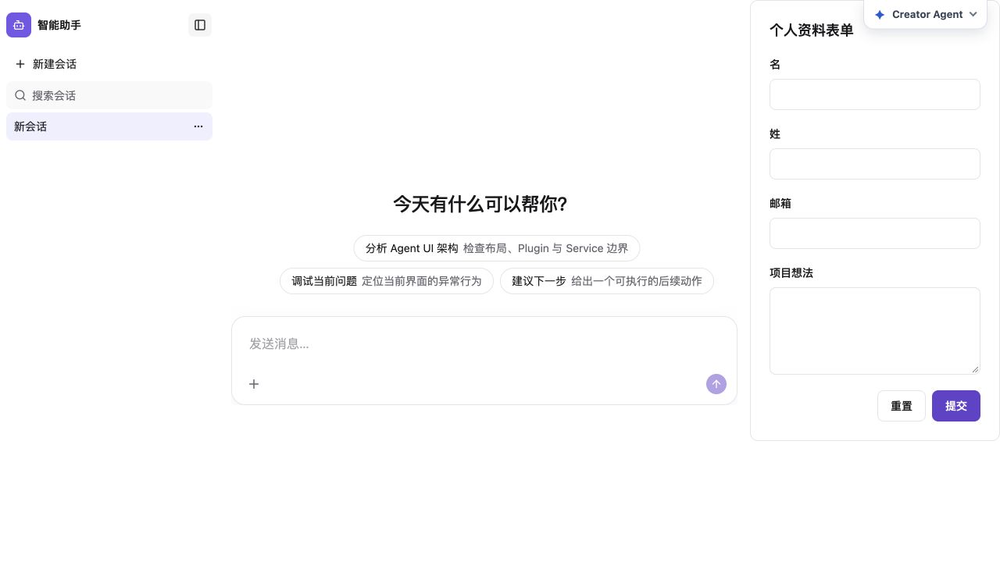

修复后：

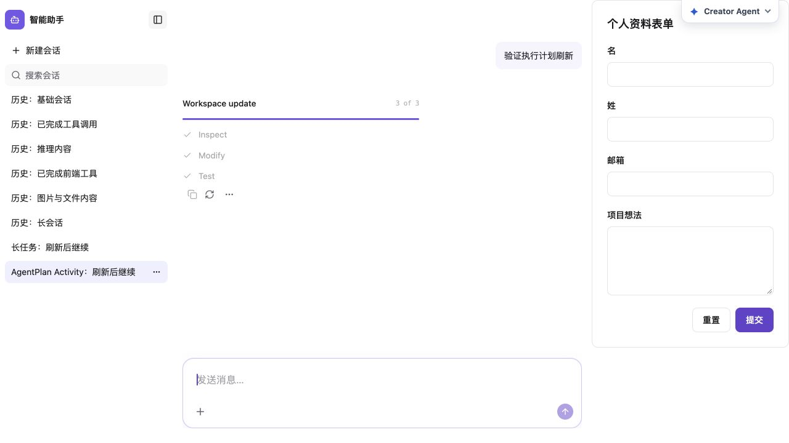

### 03 选择用户偏好后不续答

将本地旧版问答资源接入当前已有的 interrupt/resumeInterrupt 契约。源注册表模板本来已正确，不修改 Runtime 推断逻辑。

修复前：

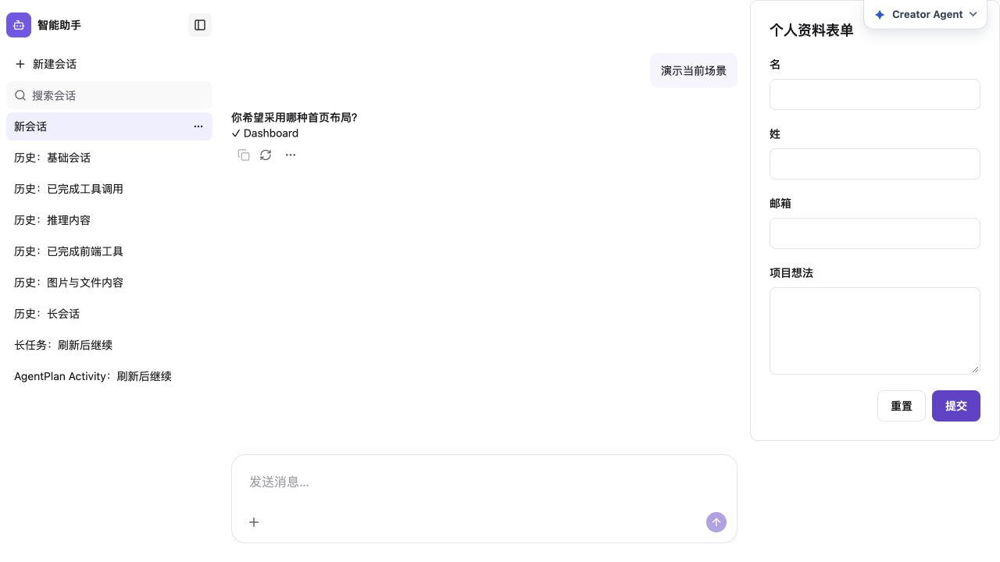

修复后：

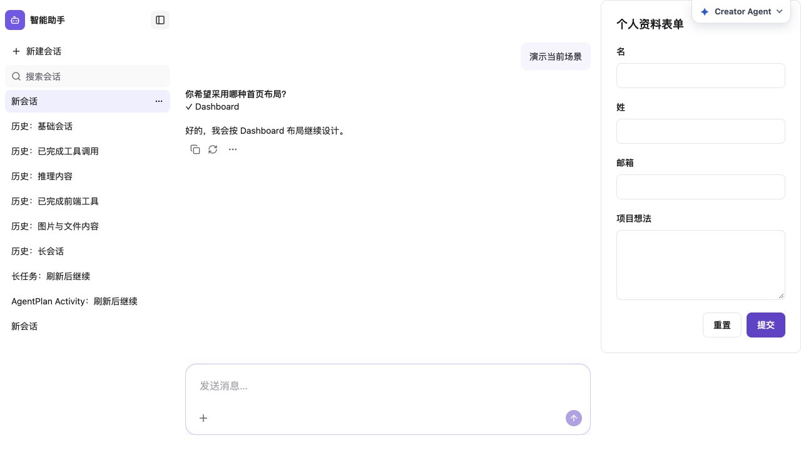

### 04 子任务失败但折叠卡片没有错误提示

增加可见的子任务失败提示。父工具本身正常返回，保留父工具 Done 状态，不把子 Agent 错误伪造成父工具协议错误。

修复前：

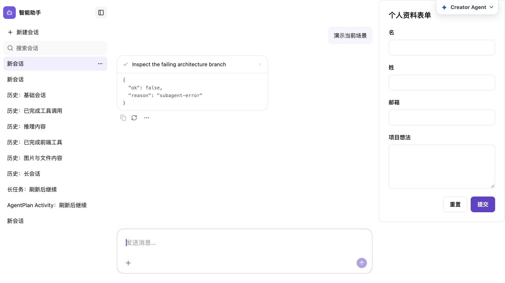

修复后：

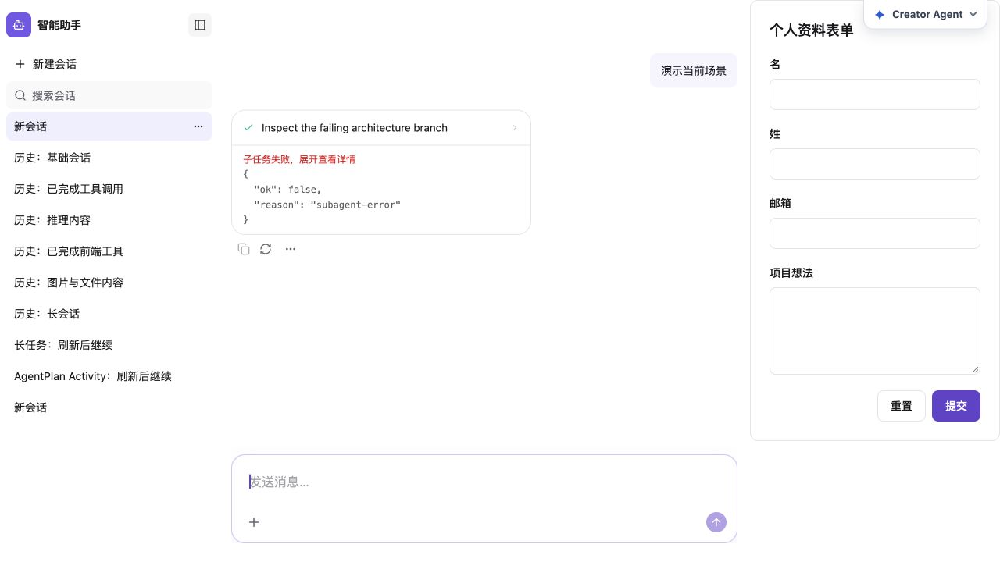

### 05 取消订单重复显示结果

取消/确认分支只发送最终 A2UI 状态卡，删除重复文本；旧卡操作变为不可交互，防止重复触发。

修复前：

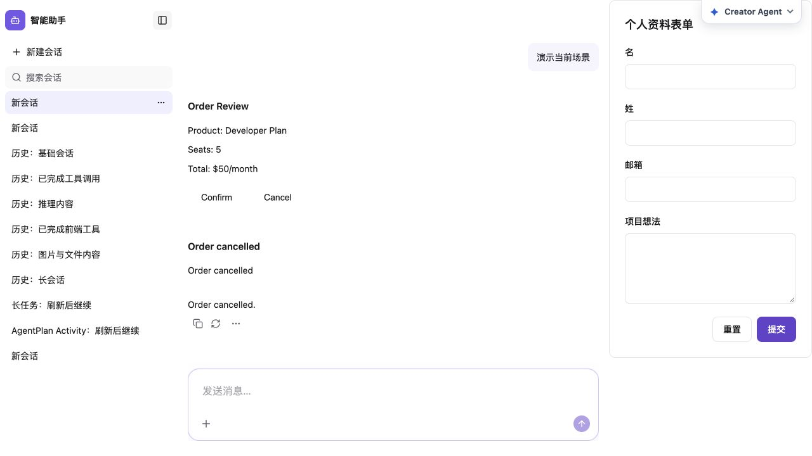

修复后：

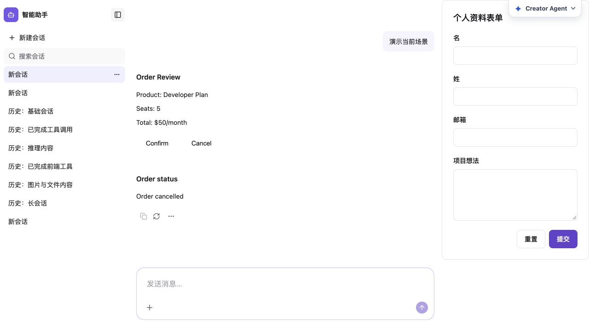

### 06 表单安装后挤窄所有 Demo

本地 AppUIModel 与后续资源安装都不再固定预留 320px。表单保持挂载，仅在当前轮包含表单工具调用时显示浮层；切到其他会话隐藏，工具服务仍可用。

修复前：

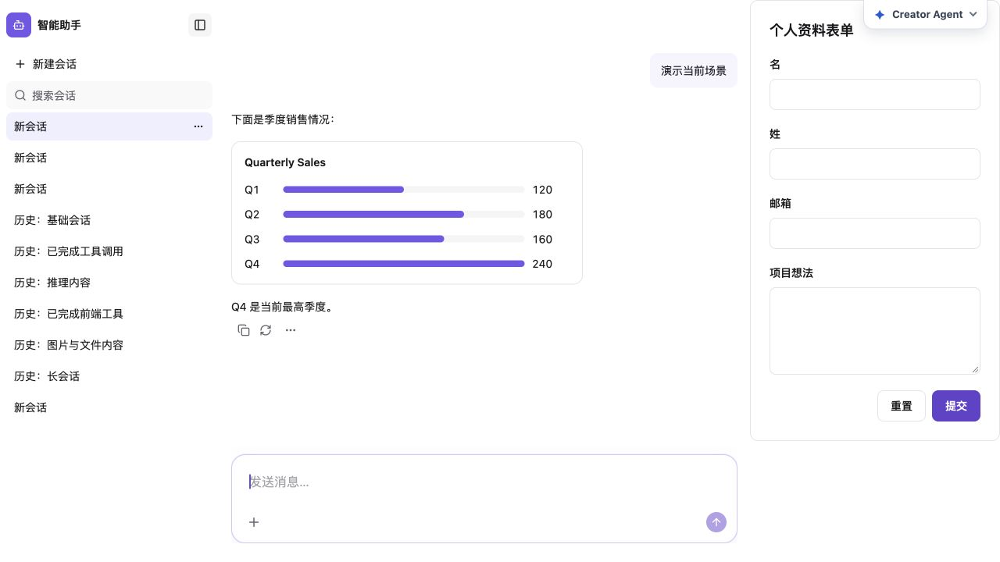

修复后：

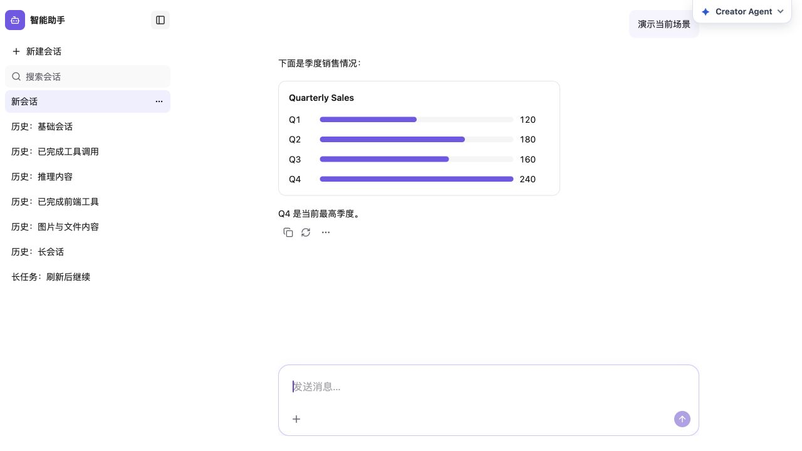

同一会话切到图表，历史表单调用保留，表单仍会隐藏：

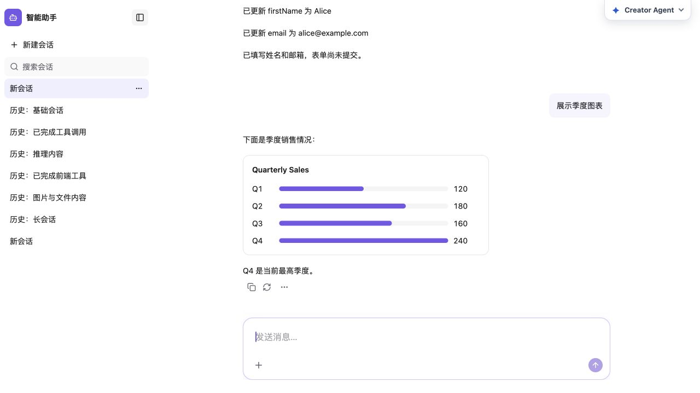

表单工具仍成功填写姓名和邮箱，未提交表单：

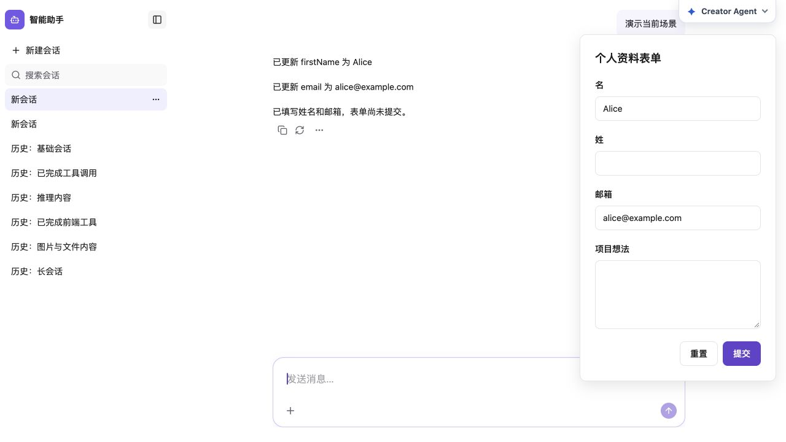

## 验证与边界

- React：A2UI 11、表单生命周期 3、子 Agent 19，共 33 个用例通过。表单增加隐藏/显示/切会话/返回会话/同会话新一轮检查；A2UI 增加旧卡操作不能发起第三次请求的检查。
- Mock：A2UI 场景 11、会话 API 7，共 18 个用例通过。会话恢复接口验证没有创建第二次运行。
- Runtime：提问 interrupt 1、刷新恢复 6 个用例通过；修正旧测试夹具以使用当前 HttpAgent 接口，生产 Runtime 源码未因此改动。
- 资源注册表 4、安装组合 3 个用例通过。
- React typecheck、Host 直接 tsc --noEmit 通过；check:i18n 无失败。
- React、Mock、Source Registry 已构建；Project Control 构建通过并重启开发服务载入新资源配置。

日志：[最终类型与资源检查](final-checks.log)、[行为回归与 i18n](regression-checks.log)、[刷新恢复测试](resume-tests.log)、[Runtime 与构建检查](owner-checks.log)、[表单最终回归与类型检查](form-final-checks.log)。

刷新恢复只对当前开发 Host 的两个持久 Mock Demo 接通；普通 Mock 对话没有因此获得服务重启后的持久存储。浏览器刷新验证在根页面完成，未宣称 Creator iframe 中所有恢复模式通过。开发服务重启会清空 Mock 内存运行。

Windows 审查：本次生产改动为 React/CSS、HTTP 数据和 AppUIModel 配置；未添加 POSIX 依赖或文件 URL/path 拼接。开发命令使用跨平台 pnpm-process helper。没有真实 Windows 浏览器验收。没有进行真实后端、附件上传或全仓库测试。

本地生成目录部分文件被 Git 忽略；[Host 修改记录](HOST-CHANGES.md) 与 [可审查的 Host 补丁](host-generated-fixes.patch) 保留本次关键修改。
