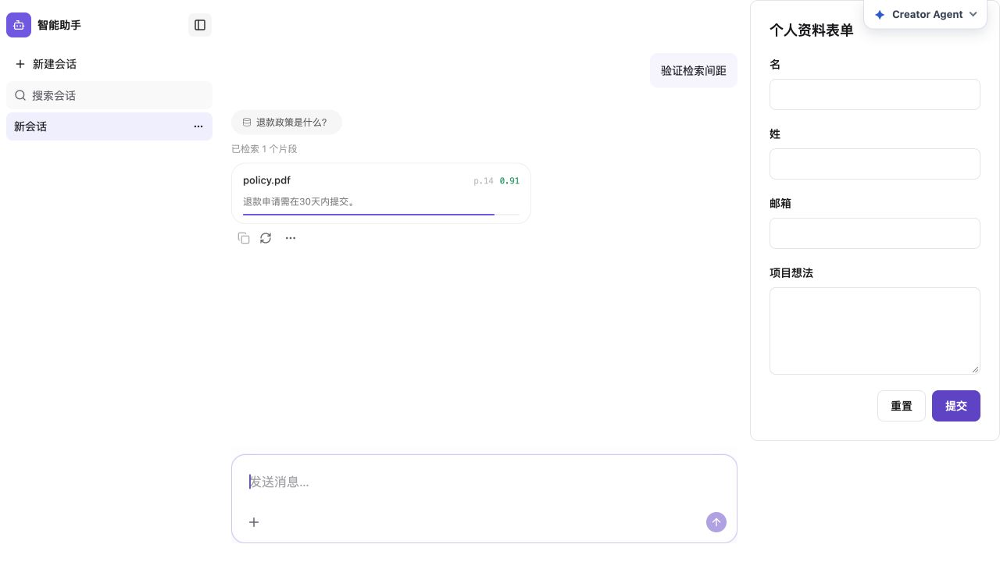
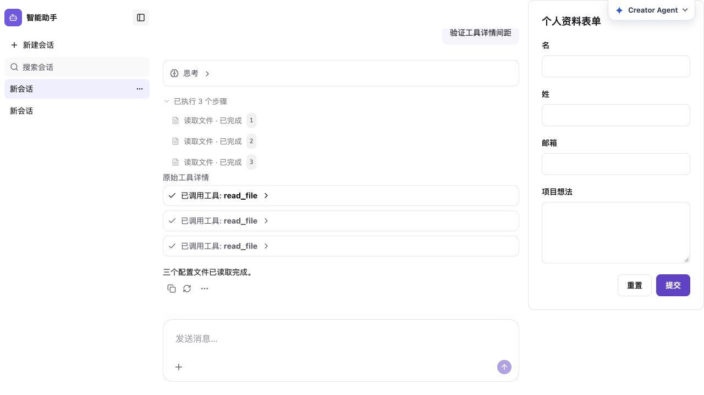
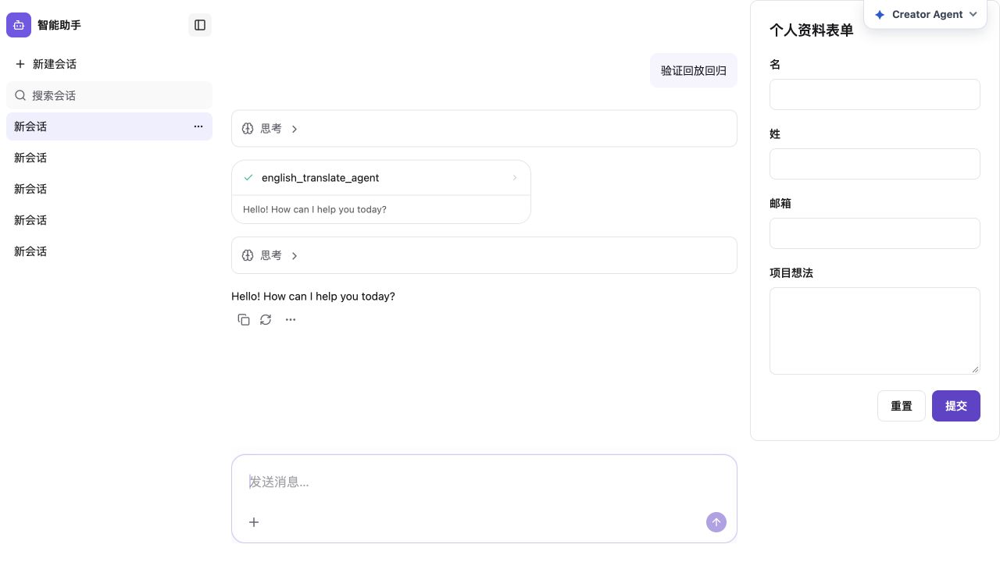

# 两处局部间距修复

- 检索完成态列表高度从112px按内容收缩到78.25px，释放33.75px空白；运行中仍保留112px占位。修改产品adapter生成器并重新生成，vendor未改。
- 原始工具详情新增局部flex容器，三张工具卡片实测间隔8px；参数与结果仍可展开。未改投影、事件或执行逻辑。
- @agent-ui/react typecheck、相关5个测试文件41项测试、build全部通过。涵盖搜索生命周期、空结果/错误fallback、Plugin禁用/移除、工具时间线投影及组合渲染。
- 实际5176预览验证检索运行中/完成态、工具详情展开和原始参数，另回归图表与子Agent翻译回放；未发现相关间距回归。图表消息parts内间隔实测16px。
- macOS实际浏览器验证；本次纯React布局变化无新增平台路径/进程假设，未做真实Windows验收。

