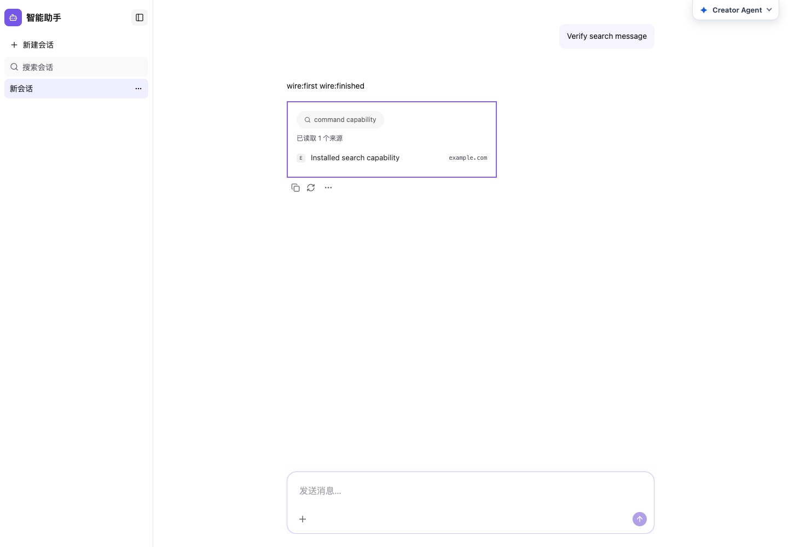

# 第七批：图表、引用来源、检索结果和网页搜索

本轮接入 `chart-message`、`source-citations-message`、`retrieval-chunks`、`web-search`，现代 npm 入口累计 **24 个**。剩余 20 个现代插件资源与兼容 ID 见 [inventory.json](inventory.json)。旧 migrated fixture 没有修改或修复。

## 交付与定制

| 插件 | 注册 | 薄应用层入口 |
| --- | --- | --- |
| chart-message | data-message: chart | figure/caption/list/item/label/track/bar/value props、formatValue、renderItem（列表项内容）/renderChart |
| source-citations-message | toolkit: search_sources | rootProps、sourceProps 工厂、renderSource/renderSources、Fallback |
| retrieval-chunks | toolkit: search_docs | retrievalProps（DOM、visibleCount、部分 labels）、renderRetrieval、Fallback |
| web-search | toolkit: web_search | searchProps（DOM、visibleResults、cycle、部分 labels）、renderSearch、Fallback |

协议名、插件 ID 和 AppUIModel 配置保持。实例位于 applicationPlugins，不通过 Layout Slot 直接挂消息 renderer。图表原 manifest 仅声明 data.messageUI，仍保留其合法的可选 capabilities；消费代码处理字段缺省，不修改 manifest 来迁就类型假设。

运行入口和 portable snapshot 都从每插件 component、package-definition、presentation/projection 生成。旧资源保留原导出名并委托同一实现，不复制共享 Runtime 或 Context。来源引用保留 URL/document 类型与验证，sourceProps 工厂返回完整判别类型；默认无额外容器，传 rootProps 时才添加 wrapper。检索/搜索保留原流式部分结果、完成时校验、requires-action/error 回退与回调，不执行 backend tool。

图表是产品自有展示，完整 JSX 和投影逻辑可接管；style.css 和 style.css.d.ts 在 portable closure 中，npm 子路径显式加载构建 CSS。有效数据的标题、数值和比例行为保留；无效结构或非有限数值省略展示，避免外部 data-message 导致渲染异常。

检索和网页搜索原语包装层补齐已有上游 DOM、可见数量及 cycle 参数。默认仍显示所有结果、cycle=0。已有工程 searchTools 文案域纳入统一 locale，保持中英文键/值并接收现有 Host overrides；应用层 partial labels 与其合并。没有新增私有语言状态，没有修改 vendor。

官方资源目录中的检索/网页搜索也切换为标准 npm 插件安装入口，修复仍指向自动源码安装的遗漏；不改变原 ID。默认创建薄层；只有原生询问得到同意后才提取当前安装版本源码。接管只切换实现 import，源码同步仅合并 source/，应用层、注册、已有 props 和历史定制均保留。不兼容的路由合同仍要求单独迁移。

## 自动验证

相关 **313 项测试通过**，见 [validation.json](validation.json)：

- Plugins 60 项：新批次 15 项，以及前批次的展示/locale/来源回归。对 npm 与实际 portable snapshot 都验证原生 chart 数据路由、默认展示、DOM/事件/样式、数量/cycle、renderer、来源 URL/document、无效数据、流式状态、审批/错误回退及现有 searchTools 覆盖。
- Operator 118 项：全部 23 个非 Composer 现代插件的接管/升级/源码同步生命周期、有/无旧 lock 的定制保留、注册与 API 变更拒绝等相关验证。图表 CSS 和其余插件 projection 均测试了本地与目标版本冲突的显式合并；应用层定制、中文注释、CRLF、插件/实例 ID 与 AppUIModel 字节保留。初次整组运行 117 项通过，官方资源断言暴露交付入口遗漏；修复真实目录与对应断言后，目录和元数据共 11 项重跑通过，去重计 118 项。
- Creator Python 133 项：包括四个新 ID 的真实 LangGraph 询问中断、同意/拒绝恢复及写入边界。
- Node 包边界 2 项。

Plugins/Operator 构建与类型检查、公开声明、i18n、上游完整性、源码分发和 diff 检查通过。实际 tarball 的 24 个现代入口、25 个 portable closure、434 个 canonical snapshot、278 个 portable/runtime 摘要均核对；CSS/声明/主题类型存在，exports 目标存在，没有打包 tests/node_modules。见 [tarball.json](tarball.json)。

## 真实生成 Host 与浏览器

运行 [验证脚本](../../../scripts/verify-search-message-delivery.mts)，证据见 [browser.json](browser.json)：

1. 使用真实初始化的独立 Host、当前构建 npm 包与官方 installOfficialAgentUIResource 入口安装四个插件，每个插件验证 passed，在 applicationPlugins 中各激活一次。
2. 在本地 web-search 薄应用层传 aria/style props，重复安装验证没有改写应用层。
3. 浏览器连接真实本地 HTTP AG-UI 事件服务，发送请求并渲染 web_search 工具结果，核对应用层 16px padding。
4. 在临时测试工程通过真实 Operator 提取当前版本源码并切换 import，验证 AppUIModel 与应用层定制保留；添加本地实现 DOM 标记后，再发送请求，核对本地源码标记、渲染结果与原 props。两次 run，pageerror=[]。这一步的测试调用直接应用计划；用户确认中断由上面的 LangGraph 测试覆盖。

npm 薄层定制：

接管后，真实页面继续显示相同的应用层定制；本地实现 DOM 标记由浏览器断言验证：

这些是生成 Host 的真实页面截图，不是演示页；没有运行真实 Creator 对话或外部模型，不将它们冒充模型完成全流程的截图。Vite 对可选 react-lexical 的预构建提示仍存在，本轮未处理；测试页面无运行错误。

## 边界

没有修复或跑全量旧 fixture，没有宣称全量测试通过。升级目标为临时合成的 0.0.2 包/插件版本，不是真实新 upstream 版本；未发布 npm。

未做原生 Windows 验收。执行了 drive/UNC/path.win32 逻辑路径检查、带中文和空格的生成工程检查及打包声明验证；新增模块/manifest 路径使用 `/`，文件访问使用 native path API，浏览器脚本使用 fileURLToPath/pathToFileURL，未引入 POSIX 启动依赖。
