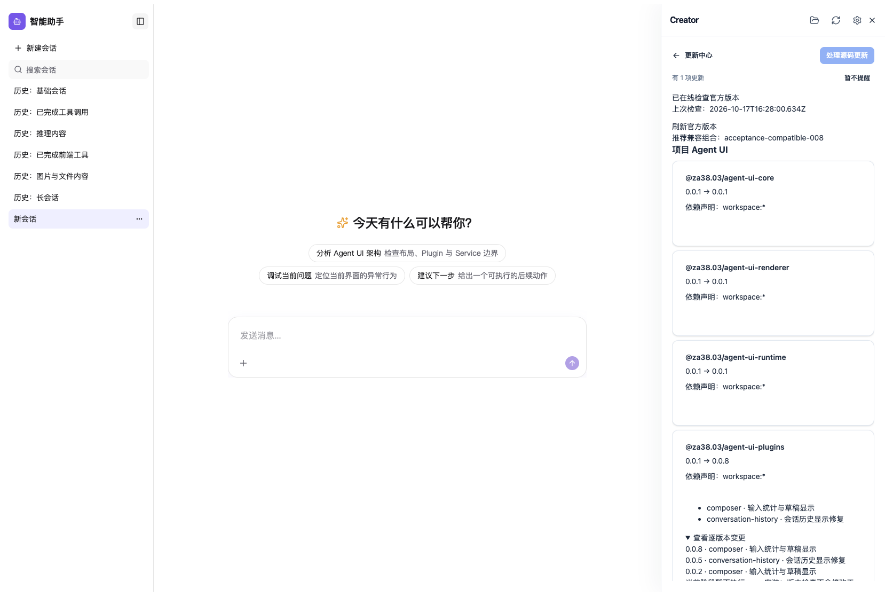
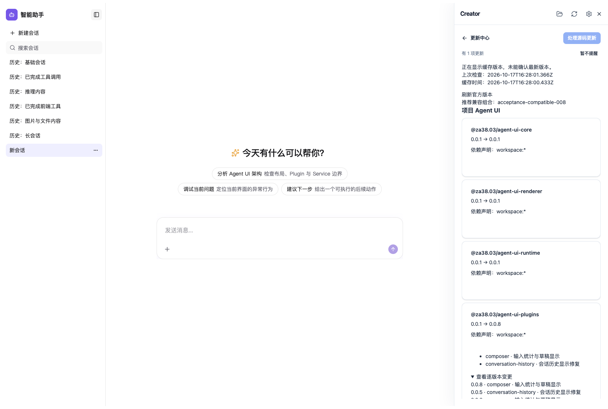

# 统一更新中心：版本发现与展示第一阶段

本轮实现真实版本来源、兼容清单校验、只读 HTTP 更新检查，以及累计/逐版本变化展示。没有实现 npm 安装升级、锁文件执行恢复、工具自升级或源码合并的新流程；已有接管和 source-only 同步保留。旧 fixture 未修复，未发布 npm。

## 实现

- Plugins 官方目录的 runtime.version 读取自身 package.json，不再固定 0.0.1。候选版本 1.2.3 的构建测试确认 npm 版本与插件内部版本分离。
- 旧源码更新服务不知道 Creator 版本时，不再默认 0.1.0；有最小 Creator 要求即阻塞。Creator 更新页继续传真实安装版本。
- 新增 Schema 1 兼容发行清单、HTTP Provider 和只读 PackageUpdateService。校验官方包身份、精确稳定版本、发行 ID、依赖范围；按实际项目/工具版本判断 Node/React/最低工具要求、缺失/声明不符/多个版本与降级。沿真实文件位置解析 pnpm 风格 symlink/peer envelope，不假设依赖全部提升到工程根。
- 默认推荐最新兼容稳定组合，并列出较新但不兼容组合及原因。变更聚合包括目标以前的发行记录，重复功能合并展示但保留逐版本条目；缺少完整性声明/历史时明确提示。
- 开发宿主设置 `CREATOR_UPDATE_MANIFEST_URL`（环境变量或宿主 `.env.creator.local`），启动/选中工程、打开更新页和手动刷新调用现有 check API。生产 feed 使用 HTTPS；本地 HTTP 仅限 loopback。没有编造默认官方地址。
- 请求有超时、2 MB 上限、并发合并、短期内存缓存、强制刷新和同 ID 内容变化校验。缓存/不可用/未配置均明确表达，不会说“已是最新”。不执行远程命令，不在工程中写缓存或修改任何源码。
- 更新中心的源码检查启用只读模式；存在中断事务时返回待恢复状态，保留日志和用户文件，不顺带自动恢复。显式源码操作的原有恢复逻辑不变。
- 同一页面区分项目 Agent UI 与 Creator 开发工具，默认 npm 包也可看到更新。现有源码更新卡片、计划、模型/手动合并与基线采用继续工作；在线目标不会成为源码同步 TARGET。
- `prepare-compatibility-release.mjs` 从七个真实包元数据准备清单，计算官方依赖及 Node/React 范围交集，可追加不可变历史记录。发布者提供变更条目；脚本不替代 npm 产物发布/可下载性核验，也不部署官方在线服务。

## 验证

去重共 **211 项测试通过**：

- Operator 首轮 199 项、7 文件，通过全部 43 个非 Composer 现代插件的接管、合成版本更新、源码合并、应用层/配置/旧定制保留，以及源码目录与 Windows 调用回归；其中包含首批 10 项兼容检查。
- 补充 pnpm peer envelope 用例后，兼容/接管/Windows 三文件 24 项重跑通过；新增 1 项计入去重总数，重复用例不重复计数。
- Creator 8 项、2 文件：原有源码更新/确认/模型合并 UI 回归，加 npm 版本与累计/历史展示、缓存/不可用/未配置不报最新，以及真实 HTTP publisher → Creator check API 联调、当前工程约束与定制不写入，以及中断事务不被后台检查自动恢复。
- 七包归属与便携路径 Node 检查 3 项。

Plugins、Operator、Creator 构建通过；三包相关类型检查（含 Operator 测试与 Creator browser 类型）通过；i18n failures=[]、Plugins 540 份 canonical snapshot/portable/runtime 摘要核对及 git diff --check 通过。三包真实 tarball 的 exports/新增公共类型核对见 [packages.json](packages.json)；打包 Operator 移到临时目录并把测试包身份设为 0.0.7 后，运行中的版本读取确认为 0.0.7，证明不依赖工作区常量。此修改只作用于临时解包副本。

## 实际 Creator 页面

[浏览器验证脚本](../../../scripts/verify-update-center.mts) 启动实际 Creator UI、Python sidecar 与真实初始化的 React Host，使用独立本地 HTTP publisher（不是公网官方发布源），没有拦截 API 或伪造页面。无需调用模型；版本/兼容判断由工具确定性完成，modelRequests=0。

[浏览器结果](browser.json) 记录默认未接管工程的 npm 版本检查、累计功能、逐版本历史展开、断网后缓存提示，pageerror=[]。所有工程应用源码、package.json、ownership/BASE 与 source-lock 检查摘要前后相等；没有安装依赖、编辑插件或推进基线。API 中 source release 仍为已安装的 0.0.1，线上示例包目标 0.0.8 仅用于展示，未被当作源码 TARGET。

此前浏览器脚本的 exact-text 定位没有包含前面的插件 ID，导致定位超时；页面/API 已有相应变更。修正定位后重跑通过，诊断保存在 previous-selector-attempt/，没有改变产品逻辑或降低断言。后续修正更新总数显示并再次重跑，最终截图来自当前代码。

## 当前边界

本阶段需要配置实际官方 feed 地址；未配置时页面明确说明，不用 fixture 顶替。没有部署正式 feed、调用公网已发布版本进行验收或进行客户端 npm 产物可用性/完整性核验。推荐表示清单要求与当前环境相容，不表示已经安装验证。npm/私有注册源凭据接入、受确认安装/恢复、工具重启、预发布渠道选择 UI 和持久缓存留待下一阶段，页面明确不提供 npm 执行。

在 macOS 执行，覆盖中文空格路径、pnpm 结构 symlink 和现有跨平台调用测试；没有原生 Windows 验收。没有跑全量旧 fixture，也未修前批 Composer 依赖图检查的旧问题。本轮不声称全部插件真实模型旅程或全仓测试通过。
