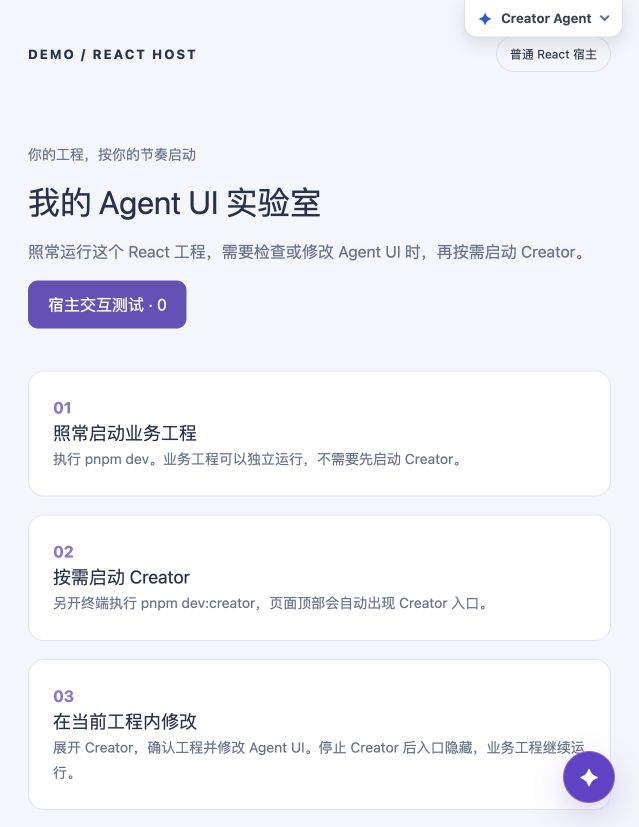
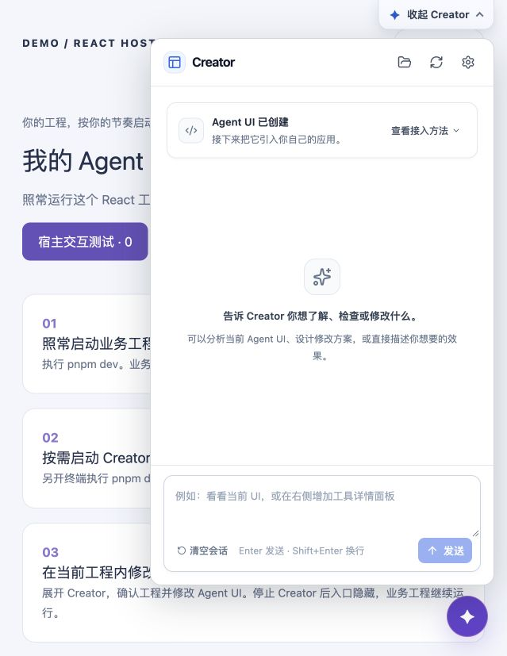

# Agent UI Creator

在你自己的开发页面里，用对话检查和修改 Agent UI。
业务工程照常启动，需要 Creator 时再单独启动它。

以下适用于 React + Vite 项目。需要 Node.js 22.12 或更新版本，以及 Python 3.11 或更新版本。

## 1. 安装

在你的工程目录执行：

```sh
pnpm add -D @za38.03/agent-ui-creator
```

## 2. 配置一次

在 `package.json` 的 `scripts` 中添加这一行，保留其他脚本：

```json
"dev:creator": "agent-ui-creator --project . --port 47832 --no-open"
```

在 `vite.config.ts` 顶部添加：

```ts
import { createCreatorDockVitePlugin } from "@za38.03/agent-ui-creator/dock/vite";
```

然后在已有的 `plugins` 数组中加上 `createCreatorDockVitePlugin()`。例如：

```ts
plugins: [react(), createCreatorDockVitePlugin()]
```

保留工程原有的插件。如果业务开发服务已经运行，配置完成后重启一次。

## 3. 需要时启动

业务工程仍用你原来的命令启动，例如 `pnpm dev`。
需要 Creator 时，另开一个终端，在同一工程目录执行：

```sh
pnpm dev:creator
```

回到业务页面，稍等几秒，顶部会出现 **Creator Agent** 入口，不需要刷新。



点击入口展开。当前工程已自动选中；新工程按界面提示选择产品形态和源码目录，完成初始化。
下面是已初始化工程的界面：



第一次对话前，请先完成 [模型配置](docs/advanced.md#模型配置)。之后可以直接告诉 Creator：

> 把这个助手调整成中文客服，保留当前业务页面。

在 Creator 终端按 **Ctrl+C** 停止，顶部入口会自动消失，业务工程继续运行。
下次需要时，再执行 `pnpm dev:creator` 即可。Creator 浮层只在开发时显示，不进入生产页面。

## 其他接入方式与常见问题

- [模型配置](docs/advanced.md#模型配置)
- [端口占用或连接不上](docs/advanced.md#端口占用或连接不上)
- [Rsbuild、Webpack、独立启动和进阶配置](docs/advanced.md)

## 把 Agent UI 接入业务页面

安装并启动 Creator、打开界面后，在“查看接入方法”中按业务工程的框架选择：

- **React 工程**：直接在页面中使用生成的 `<Agent />`；需要业务按钮控制助手时，查看 Provider 示例。
- **Vue / 其他框架**：通过 Web Component 嵌入。当前提供 Vue 接入指引，其他框架需要先检查支持情况。

Vue 首次初始化会创建独立的 React Agent UI 工程（默认目录 `agent-ui/`），展示依赖计划，确认后仅在该目录安装依赖并构建。Vue 工程保留原有依赖与入口。当前支持独立 npm/pnpm 工程；共享 workspace 的自动创建尚不支持。

Vue 用户可以把引导中的示例请求发给 Creator，并补充希望展示助手的页面和区域。Creator 会检查工程、确认当前 Agent UI 的构建产物，并展示接入方案；你确认后再执行。也可以展开“手动接入”，让 Creator 只提供步骤和代码，由你修改，完成后再请它检查。

Vue 嵌入后，可以在助手里正常聊天。但目前没有现成接口让业务按钮替助手发消息、停止回答，或读取它是否正在回复；在 Vue 外面套一个 Provider 也不能直接实现。这些功能可以通过修改 Agent UI 的接入源码来补充，再重新构建，并不是 Vue 本身做不到。

Creator 会将定制修改保存在关联的 React Agent UI 工程。修改后点击“构建并更新到宿主”，会构建该工程并更新 Vue 的 `public/agent-ui.js`；刷新开发页面查看效果。部署时再运行 Vue 工程自己的构建命令，将更新后的资源包含在部署产物中。

关联信息保存在开发配置 `.agent-ui/producer.json`，不会成为生产依赖。更新会检查源码与产物是否匹配；宿主资源被手动修改时会停止，不能静默覆盖或改用官方默认界面。独立 Agent UI 工程可使用自己的 dev、test、typecheck 和 build 脚本；生产构建不需要 Creator。上面的 React 示例不适用于 Vue 页面。

## 在宿主页面中控制助理

只展示助理时，从初始化生成的入口导入 `Agent` 并渲染 `<Agent />`。
需要业务按钮发送消息或读取运行状态时，从同一入口导入 Provider 和 Hooks：

```tsx
import { useState } from "react";
import { Agent, AgentUIProvider, useAgentUI, useAgentUIState } from "./agent-ui";

function AssistantRegion() {
  const agent = useAgentUI();
  const ready = useAgentUIState(s => s.status === "ready");
  const busy = useAgentUIState(s => s.runtime?.run.status === "running" || s.runtime?.run.status === "awaiting-input");
  const [open, setOpen] = useState(false);
  const [failed, setFailed] = useState(false);

  async function openAndSend() {
    setOpen(true);
    setFailed(false);
    try { await agent.sendMessage("请帮我分析当前页面"); }
    catch { setFailed(true); }
  }

  return <>
    <button disabled={!ready || busy} onClick={() => void openAndSend()}>打开助理并分析</button>
    {failed && <p role="alert">消息未能发送，请重试。</p>}
    <aside hidden={!open}><Agent /></aside>
  </>;
}

export default function SelfPage() {
  return <AgentUIProvider><AssistantRegion /></AgentUIProvider>;
}
```

导入路径按你的源码目录调整。Provider 是 Agent UI 的运行时接入组件，不是 UI Plugin，也不需要从 assistant-ui 引入。它不进入 AppUIModel；原来的插件树仍决定界面布局和插件是否启用。

- `user`、`locale`、`endpoint`、附件/反馈适配器等配置放在外层 `AgentUIProvider` 上，其内部使用无参数的 `<Agent />`。一个 Provider 只挂载一个展示区域；独立助理使用独立 Provider。
- `user` 及其 `userId`、`userName`、`avatar` 均可选。账户插件启用时，缺失资料显示默认值。用户资料只用于前端展示，不会自动提供给模型，也不替代宿主鉴权。
- Provider 保持挂载时，助理区域隐藏或卸载不会销毁会话；宿主仍可读取状态和发送消息。卸载 Provider 会断开宿主接口并停止当前执行。
- `useAgentUI()` 提供 `sendMessage`、`abortRun`、`startNewConversation`、`resumeInterrupts`。未就绪调用返回 `AGENT_UI_NOT_READY`；消息并发与中断继续遵循已有 Runtime 规则，不额外排队。
- `useAgentUIState(selector)` 订阅稳定字段，例如 `s.status`、`s.runtime?.run.status` 和 `s.runtime?.messages`。避免在 selector 中新建对象或数组。
- `useAgentUIEvent(name, handler)` 订阅 `ready`、`status-change`、`thread-change`、`run-start`、`run-end`。事件只通知变化；读取当前状态使用状态 Hook。`run-end` 包含完成、取消、错误和等待用户输入，不等于成功完成。
- `sendMessage()` 返回现有 Runtime 的结算 Promise；成功结算不保证模型成功回复。检查 `runtime.run` 和 `runtime.interrupts`。会话更换或 Provider 卸载会以 `AGENT_UI_SESSION_ENDED` 拒绝旧会话尚未结束的宿主发送请求，不会把请求转发给新会话。
- 退出登录、切换用户时，由宿主管理会话清理，例如卸载 Provider 或用用户 ID 作为 React `key`，并仅传入该用户的 `initialThreadId`。更新 `user` 资料本身不切换会话。

已有工程需按正常源码更新机制更新基础模板，并更新 Runtime 包；不要重新初始化或覆盖宿主已有定制。Creator 初始化后的“查看接入方法”中也提供可复制的 Provider 示例。

### 默认 npm 更新来源

更新中心直接使用目标工程的 npm registry 和凭据检查官方包版本；无需配置额外更新接口。兼容组合与变更历史随官方包发布，源码接管/同步读取实际安装的 Plugins 包 catalog 和源码快照。检查只读，安装需用户确认；npm 升级不会自动覆盖应用层和已托管源码，源码同步另行确认。尚未发布或 registry 无法访问时会明确显示不可用，不使用演示发行数据。

## Project Operator and contracts

Creator is one development-tool package, including the internal `operator/` module and canonical `contracts/` schemas/fixtures. There is no separate Operator npm package. Agent orchestration stays in Creator; project inspection, controlled mutations, validation, transactions, source operations and update planning stay in Operator. The Python sidecar and Node implementation share the same protocol, shipped in the npm artifact and Python wheel.

Public Node entry points: `/operator` (managed entry installer), `/operator/dev`, `/operator/protocol`, `/operator/host`, `/operator/resources`, `/operator/updates`, `/operator/commands`, `/bootstrap`, and `/source-registry`. Import these subpaths to use project tools without starting the Creator UI or Python sidecar. Production frontends must remain independent of Creator.

`pnpm --filter @za38.03/agent-ui-creator build` builds both modules and packages Operator runtime/types/presets. `test:operator` and `typecheck:operator` run the internal module checks; the main `test` and `typecheck` include them.
